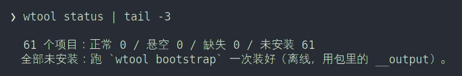

# 安装

## 1. 开发机

先有 `repo`、`git`、`python3`：

```bash
sudo apt install repo git python3
```

```bash
mkdir -p ~/self/wtool && cd ~/self/wtool
repo init -u https://github.com/allinkernel/w_manifests.git -b wtool
repo sync -j8

./install.sh
exec $SHELL              # 或重开终端

wtool                    # 所有项目，状态「未安装」
wtool bootstrap          # 全部装上
```

要装系统软件包、换 apt 源，再跑：

```bash
wtool sudo-bootstrap     # 要 root、要联网
```

`wtool bootstrap` 会跳过还没有 `__output/` 的项目。先产出，再装：

```bash
wtool build <项目>                                   # 或
wtool download-release <项目> && wtool unpack-release <项目>
wtool bootstrap
```

## 2. 断网机（整机包）

发布页：<https://github.com/allinkernel/wtool-doc/releases>（tag 形如 `offline-YYYY-MM-DD`）。

按目标机的 Ubuntu 版本下 `wtool-all-ubuntu<版本>.tar.gz` 和同名 `.sha256`。拿不准就下 22.04 那份。

```bash
cd ~
sha256sum -c wtool-all-ubuntu24.04.tar.gz.sha256
tar xf wtool-all-ubuntu24.04.tar.gz          # 得到 ~/.wtool
~/.wtool/install.sh
exec $SHELL

wtool                    # 所有项目，状态「未安装」
wtool bootstrap          # 全部装上（离线，用包里的 __output）
```



包解开后的形状：

| 项 | 状态 |
|---|---|
| 顶层 | `.wtool/` |
| `usr/` | 没有 |
| `var/` | 没有 |
| L1 链 | 没有 |
| 装完 `wtool` | 所有项目「未安装」 |
| `wtool bootstrap` | 才装项目，用包里的 `__output` |

包分卷时先拼接：

```bash
cat wtool-all-*.tar.gz.part-* > wtool-all-ubuntu24.04.tar.gz
```

解到别的目录后，跑那个目录里的 `.wtool/install.sh`。

## 3. install.sh

`install.sh` 只装 wtool 自己，不装任何项目。项目由 `wtool bootstrap` 装。

| 事项 | 行为 |
|---|---|
| rc 两行 | 整机包：自动写进 `~/.bashrc` / `~/.zshrc`，只追加、不覆盖，文件不存在就新建。开发机：交互式问一次；`--write-rc` 直接写；非交互只打印 |
| `~/.zshenv` | 不创建。zsh 的 `module_path` / `fpath` 写在 `$WTOOL_HOME/.zshenv` |
| 装完状态 | `wtool` 能跑；所有项目「未安装」 |
| 项目 | 一个都不装 |

| 参数 | 说明 |
|---|---|
| `--home <目录>` | 装到指定目录（`$WTOOL_HOME`） |
| `--prefix <目录>` | 装到 `<目录>/.wtool`，并进入 portable 模式 |
| `--portable` | 借用机器模式：不改 `~/.bashrc` / `~/.zshrc` |
| `--write-rc` | 直接写 rc 两行 |
| `--no-rc` | 不写 rc，只打印 |
| `--dry-run` | 只打印计划 |

## 4. portable 模式（借用别人的机器）

```bash
mkdir -p ~/wangshaowei && cd ~/wangshaowei
tar xf ~/下载/wtool-all-ubuntu24.04.tar.gz       # 得到 ~/wangshaowei/.wtool
~/wangshaowei/.wtool/install.sh --portable
source ~/wangshaowei/wtool-bashrc                # zsh：source ~/wangshaowei/wtool-zshrc
wtool bootstrap
```

- 不碰 `~/.bashrc` / `~/.zshrc`。
- 生成 `~/wangshaowei/wtool-bashrc` 和 `~/wangshaowei/wtool-zshrc`，每次开 shell 手动 `source` 一个。
- 等价写法：`install.sh --prefix ~/wangshaowei`。

## 5. 落点与 `$WTOOL_HOME`

| 场景 | `.wtool` 落点 | 进 PATH 的方式 |
|---|---|---|
| 自己的机器 | `~/.wtool` | `~/.bashrc` / `~/.zshrc` 末尾两行 |
| 借用机器 | `~/wangshaowei/.wtool` | `source ~/wangshaowei/wtool-bashrc`（zsh 用 `wtool-zshrc`） |

两行是：

```bash
export WTOOL_HOME=~/.wtool
source ${WTOOL_HOME}/env.zsh          # bash 写 env.bash
```

`$WTOOL_HOME` 就是 `.wtool` 根目录。项目、产物、账本、日志都在它下面。

## 6. 下载

| 要什么 | 去哪 |
|---|---|
| 整机包 | <https://github.com/allinkernel/wtool-doc/releases>，tag `offline-…` |
| 各项目的包 | [download.md](download.md) |

`download.md` 由 `wtool refresh-downloads` 生成，不要手改。

## 7. 卸载

```bash
wtool uninstall <项目路径>       # 一个项目，如 terminal/tmux
wtool uninstall all              # 所有项目
wtool sudo-uninstall all         # 系统层（/etc + apt）
```

卸 wtool 自己：

```bash
./uninstall.sh                                # 开发机：工作区根目录
~/.wtool/wtool/uninstall.sh                   # 整机包：.wtool 里的工作区根
```

`wtool kill-self-forever` 会连账本、rc 两行、本机日志一起删，要逐字输入 `KILL-SELF-FOREVER`。

## 8. 常见问题

### `wtool: command not found`

```bash
exec $SHELL
```

还不行就看 `~/.bashrc` / `~/.zshrc` 末尾有没有 `export WTOOL_HOME=…` 和 `source ${WTOOL_HOME}/env.zsh` 两行。

### `wtool check` 退出码是 0，但项目没装

`wtool check` rc=0 只表示声明、账本、磁盘三者一致，不代表项目已安装。是否安装看：

```bash
wtool status
```

### `~/usr` 不存在

正常。`~/usr` 不再创建。装完只有 `~/.wtool/` 和 rc 两行。

### `wtool check` 报对不上

```bash
wtool repair <项目>                          # 补链接 / env 块
wtool uninstall <旧路径> --no-script         # 改过名的旧账
wtool install <项目>                         # 项目脚本装的实体也缺了
```

### `env -i` 下 zsh 的动态模块加载不到

`env -i` 不会继承 `ZDOTDIR`。手工带上：

```bash
env -i ZDOTDIR=~/.wtool zsh
```

### 整机包选哪个版本

按目标机的 Ubuntu 版本选。拿不准用 22.04：它要求最低。
