# wtool 命令与工具手册

安装见 [install.md](install.md)。每条命令写三块：功能、参数、运行结果。

## 安装器与引擎

### wtool

**功能**：不带参数，打印项目总览表。

**参数**：无。

**运行结果**（列有省略）：

```text
┌────────────────────────────┬──────┬────────┬────────┬────────┐
│ 项目                       │ prio │  构建  │  安装  │  卸载  │
├────────────────────────────┼──────┼────────┼────────┼────────┤
│ shell/zsh                  │ 1    │ 可执行 │ 可执行 │ 未安装 │
│ os/ubuntu                  │ 5    │ 不支持 │ 不支持 │ 不支持 │
│ wtool-base-tools           │ 5    │ 不支持 │ 可执行 │ 未安装 │
│ …                          │ …    │ …      │ …      │ …      │
└────────────────────────────┴──────┴────────┴────────┴────────┘
```

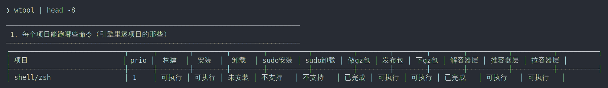

### wtool help

**功能**：打印命令清单、参数和目录说明。

**参数**：

| 参数 | 说明 |
|---|---|
| `-v` / `--verbose` | 追加 install / release 流程图和计划明细 |

**运行结果**：

```text
  ── 日常三条 ───────────────────────────────────────────────
  wtool sudo-install <项目>... [--dry-run] [--force]
  wtool install      <项目目录> [--dry-run] [--force] [--no-script] [--prune]
  wtool uninstall    <项目路径>|all [--dry-run] [--force] [--no-script]
  …
```

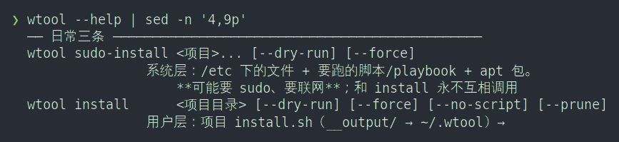

### wtool version

**功能**：打印引擎版本。

**参数**：无。

**运行结果**：

```text
wtool engine 1.0.0
```

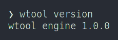

### wtool doctor

**功能**：打印环境、路径、账本、依赖版本。

**参数**：

| 参数 | 说明 |
|---|---|
| `--quiet` / `-q` / `--json` | 只输出 `export` 行，可直接 `eval` |

**运行结果**：

```text
wtool: engine      : 1.0.0
wtool: bootstrap   : /home/you/self/wtool/wtool-base-tools
wtool: root        : /home/you/self/wtool
wtool: home        : /home/you/.wtool  (.wtool 根；WTOOL_HOME 由 rc 里那两行声明)
wtool: state       : /home/you/.wtool/var  (账本，跟着 .wtool 走)
wtool: prefix      : /home/you/.wtool/usr  (编译安装前缀)
wtool: os          : ubuntu 24.04 (noble) like=debian
wtool: arch/jobs   : x86_64 / 32
```

```bash
eval "$(wtool doctor --quiet)"
```

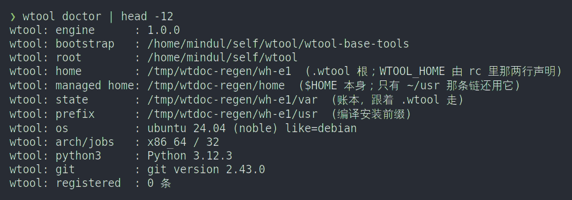

### wtool status

**功能**：不带项目，列出每个项目的状态；带项目，逐列给出状态、对应命令和依据。

**参数**：

| 参数 | 说明 |
|---|---|
| `<项目>` | 项目路径或末段名，如 `terminal/tmux`、`tmux` |
| `--color=auto\|always\|never` | 是否带颜色 |

**运行结果**：

```text
  PROJECT                            KIND       状态       说明
  ----------------------------------------------------------------------------------------
  terminal/tmux                      source     正常       -
  dsh-projects/dsh-conf              source     未安装      还没装（wtool bootstrap / wtool install）
  …
  61 个项目：正常 1 / 悬空 0 / 缺失 0 / 未安装 60
```

```text
项目 terminal/tmux（prio 50）  /home/you/self/wtool/terminal/tmux
  一列一个命令；状态就是看板里那一格，依据 = 「这一格是怎么看出来的」。

┌──────────┬────────┬────────────────────────┬───────────────────────────────────────────────────┐
│ 列       │  状态  │ 对应命令               │ 依据（这一格是怎么看出来的）                      │
├──────────┼────────┼────────────────────────┼───────────────────────────────────────────────────┤
│ 构建     │ 不支持 │ wtool build            │ 有 scripts/build.sh；__output/ 还没有             │
│ 安装     │ 已完成 │ wtool install          │ 有 scripts/install.sh；安装记录 3 条              │
│ 卸载     │ 可执行 │ wtool uninstall        │ 安装记录 3 条 → 撤得掉                            │
│ …        │ …      │ …                      │ …                                                 │
└──────────┴────────┴────────────────────────┴───────────────────────────────────────────────────┘
```

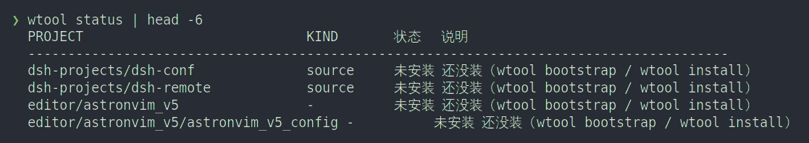
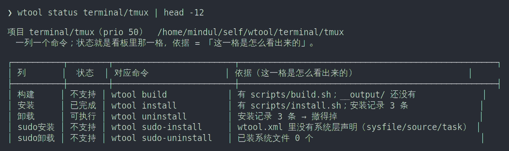

### wtool check

**功能**：对比声明、账本、磁盘，只报不改。

**参数**：

| 参数 | 说明 |
|---|---|
| 无 | 看全部项目 |
| `<项目>` | 只看一个项目 |

**运行结果**：

```text
$ wtool check
wtool: 一切对得上（声明 / 日志 / 磁盘）
```

退出码 0。有问题的退出码非 0，例如：

```text
wtool: [terminal/tmux] 还没装过（wtool install <路径>）
```

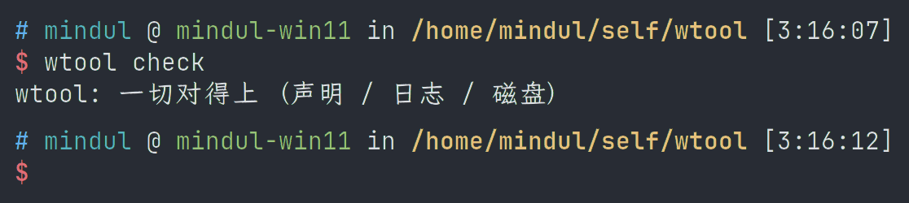
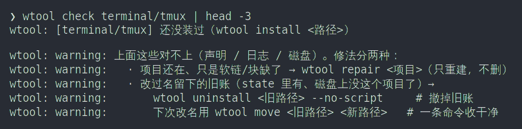

### wtool repair

**功能**：重建 `check` 报出来的链接和 env 块；不删除、不跑项目脚本。

**参数**：

| 参数 | 说明 |
|---|---|
| `<项目>` / `all` | 修一个或全部；不给就是 `all` |
| `--dry-run` | 只打印要补什么 |

**运行结果**：

```text
$ wtool repair terminal/tmux --dry-run
wtool: ── repair terminal/tmux
project   : terminal/tmux
root      : /home/you/self/wtool/terminal/tmux
l1        : /home/you/.wtool/wtool/terminal/tmux
actions   : 1 条链（0 要新建 / 1 已在）, 2 rc
wtool:   - [dry-run] 写文件 /home/you/.wtool/var/terminal/tmux/env.zsh（内容来自 …）
wtool: repair 计划完成（1 个项目）
```

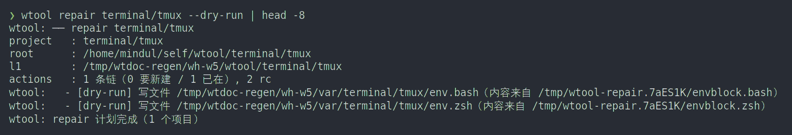

### wtool refresh-downloads

**功能**：重写 `download.md` 里的下载链接块。

**参数**：

| 参数 | 说明 |
|---|---|
| `--dry-run` | 只打印会改哪个文件 |
| `wtool docs refresh` | 同一条命令的另一种写法 |

**运行结果**：

```text
$ wtool refresh-downloads --dry-run
wtool:   - [dry-run] 刷新下载链接块: wtool-doc/download.md
```

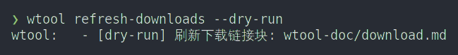

### wtool kill-self-forever

**功能**：删除 wtool 的链接、账本、rc 两行和本机日志。不可逆。

**参数**：

| 参数 | 说明 |
|---|---|
| `--dry-run` | 只打印会删什么 |
| `--yes` | 跳过逐字确认（脚本用） |

**运行结果**（节选）：

```text
wtool: kill-self-forever 会删掉下面这些（**不可逆**）：

  【$HOME 里的软链】1 条，都是 wtool 自己建的（只删还指向 wtool 的）
  【$WTOOL_HOME（.wtool 根）】/home/you/.wtool
  【账本】/home/you/.wtool/var
  【rc 里 wtool 的东西】/home/you/.zshrc 和 /home/you/.bashrc 里 wtool 那两行/旧块
  【本机日志】/home/you/.local/state/wtool

确认要删，请逐字输入 KILL-SELF-FOREVER：
```

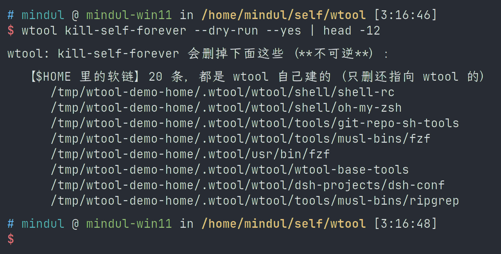

### 内部命令

这些名字不是给日常用的。

| 名字 | 怎么敲 | 用途 |
|---|---|---|
| `_complete` | `wtool _complete <词>` | Tab 补全候选 |
| `_layer-save` | `wtool _layer-save <项目> --image=<镜像>` | docker 镜像 → `__layer/` |
| `_layer-load` | `wtool _layer-load <项目>` | `__layer/` → docker |
| `kind-caps` | `python3 lib/wtool_plan.py kind-caps --command <命令> --root <工作区>` | 查项目支持哪些命令 |
| `health` | `python3 lib/wtool_plan.py health --root <工作区>` | 项目健康状态 |
| `render-env-file` | `python3 lib/wtool_plan.py render-env-file --home … --state … --shell zsh` | 生成 `env.zsh` / `env.bash` |
| `render-zshenv` | `python3 lib/wtool_plan.py render-zshenv` | 生成 `$WTOOL_HOME/.zshenv` |

`wtool kind-caps`、`wtool health`、`wtool render-env-file` 都是未知命令。

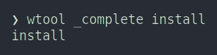

## 项目管理

### wtool install

**功能**：安装一个项目：建 `$WTOOL_HOME/wtool/<路径>` 链接、写 env 块、跑项目 `install.sh`。

**参数**：

| 参数 | 说明 |
|---|---|
| `<项目路径>` | 相对工作区根，如 `terminal/tmux`；也认绝对路径和末段名 |
| `all` | 装所有项目，等同 `wtool bootstrap` |
| `--dry-run` | 只打印计划 |
| `--force` | 目录有未提交改动也装 |
| `--no-script` | 不跑项目自己的 `install.sh` |
| `--prune` | 清掉清单里已删的旧软链 |

**运行结果**：

```text
$ wtool install terminal/tmux
wtool: 规划 /home/you/self/wtool/terminal/tmux
project   : terminal/tmux
root      : /home/you/self/wtool/terminal/tmux
l1        : /home/you/.wtool/wtool/terminal/tmux
actions   : 1 条链（0 要新建 / 1 已在）, 2 rc
wtool: project: terminal/tmux
wtool:   - check /home/you/.wtool/wtool/terminal/tmux -> /home/you/self/wtool/terminal/tmux（已在，只记账）
wtool: install 完成
```

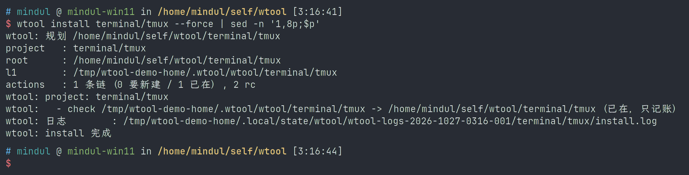

### wtool uninstall

**功能**：撤销一个项目或全部项目。

**参数**：

| 参数 | 说明 |
|---|---|
| `<项目路径>` / `all` | 项目写完整路径；`all` 撤所有装过的项目 |
| `--dry-run` | 只打印计划 |
| `--force` | 忽略检查 |
| `--no-script` | 不跑项目自己的 `install.sh --uninstall` |

**运行结果**：

```text
$ wtool uninstall terminal/tmux
project   : terminal/tmux
actions   : 0 rc
wtool: project: terminal/tmux
wtool: uninstall 完成
```

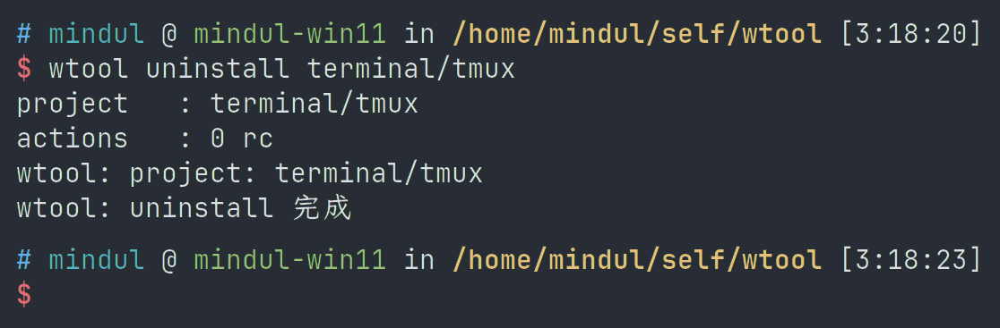

### wtool move

**功能**：项目改名：卸旧的、移动目录、装新的。

**参数**：

| 参数 | 说明 |
|---|---|
| `<旧路径> <新路径>` | 相对工作区根或绝对路径 |
| `--dry-run` | 只打印三步计划 |
| `--force` | 忽略检查 |
| `--no-script` | 不跑项目脚本 |

**运行结果**：

```text
$ wtool move terminal/tmux terminal/tmux2 --dry-run
wtool: [dry-run] 改名计划：terminal/tmux  →  terminal/tmux2
wtool:   - [dry-run]   1/3 wtool uninstall terminal/tmux
wtool:   - [dry-run]   2/3 mv /home/you/self/wtool/terminal/tmux  →  /home/you/self/wtool/terminal/tmux2
wtool:   - [dry-run]   3/3 wtool install /home/you/self/wtool/terminal/tmux2
wtool: [dry-run] 目录、state、$HOME 软链都没碰（--dry-run）
```

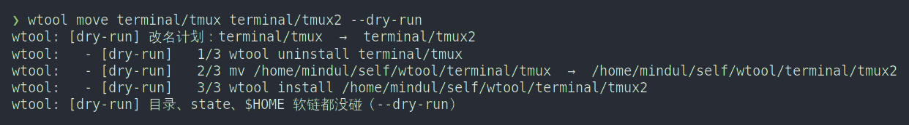

### wtool bootstrap

**功能**：按 priority 顺序把所有项目 `install` 一遍。

**参数**：

| 参数 | 说明 |
|---|---|
| `--dry-run` | 只打印计划 |
| `--force` | 目录有未提交改动也装 |
| `--prune` | 每个项目顺手清旧软链 |

**运行结果**（节选）：

```text
wtool: 扫描项目: /home/you/self/wtool

=== [1] shell/zsh ===
…
共 54 个项目：已安装 0（待装 53），已发布 0（待发 52），待构建 1
```

需要产物的项目会跳过；先 `wtool build <项目>` 或 `wtool download-release <项目>` + `wtool unpack-release <项目>`。

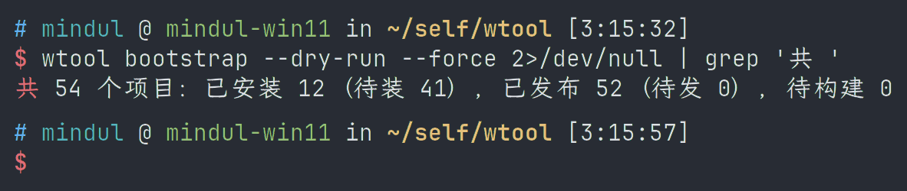

### wtool init

**功能**：新建项目模板：`wtool.xml`、`env.zsh`、`env.bash`、`scripts/`。

**参数**：

| 参数 | 说明 |
|---|---|
| `<目录>` | 工作区里的目录，如 `demo/foo` |
| `--priority N` | priority，默认 100 |
| `--with-build` | 生成 `scripts/build.sh` |
| `--with-install` | 生成 `scripts/install.sh` |
| `--all` | 两个脚本都生成 |

**运行结果**：

```text
wtool: 生成 wtool.xml
wtool: 生成 env.zsh
wtool: 生成 env.bash
wtool: 生成 scripts/build.sh  (能构建)
wtool: 生成 scripts/install.sh  (能安装)
wtool: 已生成项目: demo/foo  (id=demo/foo priority=55)
wtool: 下一步：填 wtool.xml，然后 wtool validate demo/foo
```

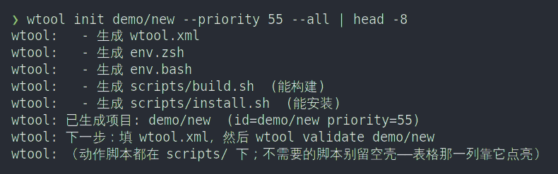

### wtool validate

**功能**：检查项目的 `wtool.xml`。

**参数**：

| 参数 | 说明 |
|---|---|
| `<项目目录>` | 要检查的目录 |

**运行结果**：

```text
$ wtool validate terminal/tmux
ok: terminal/tmux
```

有错时打印 `error: …`，退出码非 0。

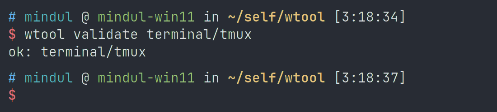

## 系统层

`os/ubuntu` 声明了三项：apt 源、基础软件包、重型工具链（`WTOOL_HEAVY=1` 才装）。

### wtool sudo-install

**功能**：装系统层：`/etc` 下的文件、apt 包、playbook。

**参数**：

| 参数 | 说明 |
|---|---|
| `<项目>...` | 一个或多个项目，如 `os/ubuntu` |
| `--dry-run` | 只打印计划 |
| `--force` | 忽略检查 |

**运行结果**：

```text
$ wtool sudo-install os/ubuntu --dry-run
wtool: ── os/ubuntu  系统层
wtool: warning: when=os:ubuntu,env:WTOOL_HEAVY 不匹配，跳过任务 重型工具链（需要 WTOOL_HEAVY=1）
project   : os/ubuntu
actions   : 1 sysfile, 0 source, 1 task
wtool: 系统文件[replace]: /etc/apt/sources.list.d/ubuntu.sources  (apt 源（跟随 install.sh 里挑的那个镜像）)
wtool:   - [dry-run] 备份 /etc/apt/sources.list.d/ubuntu.sources
wtool:   - [dry-run] 写系统文件 /etc/apt/sources.list.d/ubuntu.sources
wtool: task[ansible]: 基础软件包（常用工具 + 搜索 + 构建基础）
wtool: sudo-install 完成: os/ubuntu
```

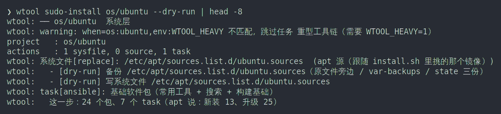

### wtool sudo-uninstall

**功能**：撤销系统层：还原 `/etc` 文件，卸掉这次装进来的 apt 包。

**参数**：

| 参数 | 说明 |
|---|---|
| `<项目>...` / `all` | 要撤的项目；`all` 撤所有有系统层记录的项目 |
| `--dry-run` | 只打印计划 |
| `--force` | 忽略检查 |

**运行结果**：

```text
$ wtool sudo-uninstall os/ubuntu
wtool: 还原系统文件[replace]: /etc/apt/sources.list.d/ubuntu.sources  (apt 源)
wtool: sudo-uninstall 完成: os/ubuntu
```

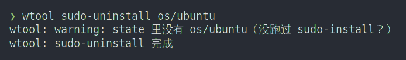

### wtool sudo-bootstrap

**功能**：对所有项目跑一遍 `sudo-install`。

**参数**：

| 参数 | 说明 |
|---|---|
| `--dry-run` | 只打印计划 |
| `--force` | 忽略检查 |

**运行结果**：

```text
=== [5] os/ubuntu ===
wtool: ── os/ubuntu  系统层
project   : os/ubuntu
actions   : 1 sysfile, 0 source, 1 task
wtool: sudo-install 完成: os/ubuntu
wtool: sudo-bootstrap 完成（1 个项目）
```

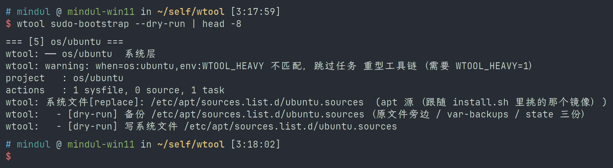

## 构建、打包与发布

| 项目类型 | 可用命令 |
|---|---|
| `kind="source"` | `install`、离线包 |
| `kind="muslbin"` | `download-release`、`unpack-release`、`install`、离线包 |
| `kind="docker"` | `build`、`pack-release`、`publish-release`、`download-release`、`unpack-release`、层命令、`install`、离线包 |

### wtool build

**功能**：构建项目，产物写进 `__output/`。

**参数**：

| 参数 | 说明 |
|---|---|
| `<项目>...` / `all` | 要构建的项目 |
| `--dry-run` | 只打印计划 |
| `--force` | 忽略机器门槛检查 |
| `--target=<目标>` | 只构建某个发行版，如 `ubuntu_24.04` |
| `--jobs=N` | 并行层数 |
| `--rebuild` | 无视已完成标记，强制重跑 |

**运行结果**：

```text
$ wtool build shell/zsh --dry-run
wtool: ── shell/zsh
wtool:   方式 : docker
wtool: ── shell/zsh  目标 ubuntu_24.04（基础镜像 ubuntu:24.04）
wtool:   - [dry-run] main ← - → wtool/zsh-usr:ubuntu_24.04
wtool:   -          容器里: sh /proj/scripts/build.sh --in-docker --target=ubuntu_24.04
wtool: dry-run：以上 3 个目标的计划，什么都没执行（没有起容器、没写 __layer/ / __output/）
wtool: build 完成（1 个项目）
```

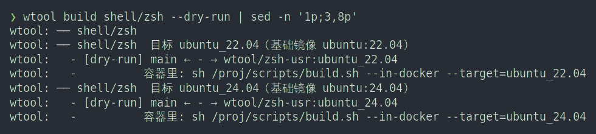

### wtool download-release

**功能**：把包下载到项目的 `__release/`，只下载、不解包。

**参数**：

| 参数 | 说明 |
|---|---|
| `<项目>...` / `all` | 要下载的项目；不给就列出可下载的项目 |
| `--dry-run` | 只打印要下载的 URL |

**运行结果**：

```text
$ wtool download-release tools/musl-bins/bat --dry-run
wtool: ── tools/musl-bins/bat
wtool:   声明 : wtool.xml 的 <muslbin>（上游二进制；tag v0.26.1）
wtool:   落点 : __release/
wtool:   - [dry-run] bat-v0.26.1-x86_64-unknown-linux-musl.tar.gz  ← https://github.com/sharkdp/bat/releases/download/v0.26.1/…
wtool: download-release 完成（1 个项目）
```

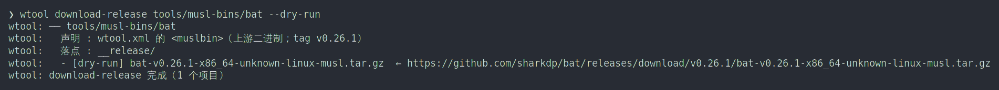

### wtool unpack-release

**功能**：按 `scripts/release.json` 校验并解开 `__release/` 里的包，写进 `__output/`。

**参数**：

| 参数 | 说明 |
|---|---|
| `<项目>...` / `all` | 要解的项目 |
| `--from=<目录>` | 包在别的目录 |
| `--dry-run` | 只打印计划 |

**运行结果**：

```text
$ wtool unpack-release tools/musl-bins/bat --dry-run
wtool: ── bat
wtool:   - [dry-run] 从 bat-v0.26.1-x86_64-unknown-linux-musl.tar.gz 里取成员 [bat-v0.26.1-x86_64-unknown-linux-musl/bat] → …/__output/usr/bin/bat（并校验 sha256）
wtool: dry-run：以上 1 条的计划，什么都没解开（__output/ 一个字节都没写）
wtool: unpack-release 完成（1 个项目）
```

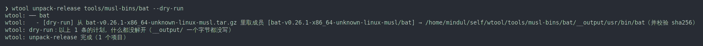

### wtool pack-release

**功能**：打包到项目的 `__release/`：`source.zip`、`release.zip`、`dist.json`、校验文件，并写项目里的 `docs/download.md`。只适用于 `kind="docker"`。

**参数**：

| 参数 | 说明 |
|---|---|
| `<项目>...` | 要打包的项目 |
| `--tag=<tag>` | 指定 tag，默认按模板 |
| `--repo=<owner/repo>` | 指定目标仓，默认取项目 remote |
| `--volume-size=<大小>` | 分卷大小，默认 `32M` |
| `--dry-run` | 只打印计划 |
| `--force` | 忽略检查 |

**运行结果**：

```text
$ wtool pack-release shell/zsh --dry-run
wtool: ── shell/zsh
wtool:   目标仓 : allinkernel/wtool-zsh
wtool:   tag    : snapshot-2026-10-23
wtool:   卷大小 : 32M
wtool:   - [dry-run] source.zip  ← 1743 个文件
wtool:   - [dry-run] release.zip ← 3829 个文件 + 声明面 wtool.xml,env.zsh,env.bash
wtool:   - [dry-run] 写 …/shell/zsh/__release/：dist.json、source-hash.txt、release-hash.txt、超 32M 就切分卷
wtool: pack-release 完成（1 个项目）
```

`kind="source"` / `kind="muslbin"` 会报不支持：

```text
wtool: 'terminal/tmux' 是 kind=source（纯源码项目），不支持 pack-release —— 它没有产物包 —— 源码即产物，离线包走 pack-offline-release
```

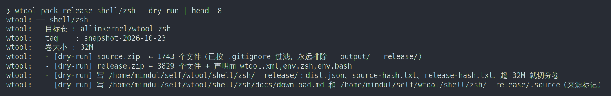
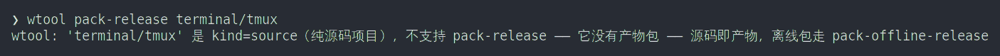

### wtool publish-release

**功能**：把 `__release/` 里的包上传到 GitHub Release，上传成功后写 `scripts/release.json`。只适用于 `kind="docker"`。

**参数**：

| 参数 | 说明 |
|---|---|
| `<项目>...` | 要发布的项目；不给就发所有可发布项目 |
| `--tag=<tag>` | 指定 tag |
| `--dry-run` | 只打印上传清单 |
| `--force` | 同一 commit 重发时不再询问 |
| `--allow-foreign` | 允许发到第三方仓 |
| `--out=<目录>` | 发布后另拷一份产物 |

**运行结果**：

```text
$ wtool publish-release shell/zsh --dry-run
wtool: ── shell/zsh
wtool:   目标仓 : allinkernel/wtool-zsh
wtool:   tag    : snapshot-2026-10-23
wtool:   target : 970154c2458686af57032b969d10cb01db1b08cf（这一版打包用的 commit）
wtool:   - [dry-run] 上传 5 个文件 → allinkernel/wtool-zsh snapshot-2026-10-23
wtool:   - [dry-run] 资产（5 个）: dist.json release-hash.txt release.zip source-hash.txt source.zip
wtool:   - [dry-run] 之后写 scripts/release.json（记得提交）
wtool:   - [dry-run] 刷新下载链接块: wtool-doc/download.md
```

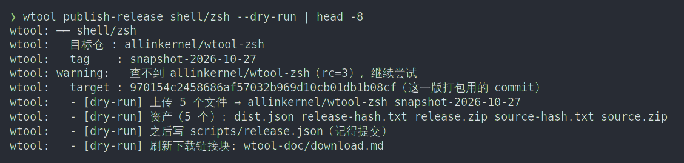

### wtool pack-offline-release

**功能**：打离线自足包。

**参数**：

| 参数 | 说明 |
|---|---|
| `<项目>...` | 逐项目打：`source-offline.zip`、`release-offline.zip`、`wtool-base-tools.tar.gz` |
| `each` | 所有项目逐项目各打一个 |
| `all` | 整机迁移包：`wtool-all-ubuntu<版本>.tar.gz` |
| `--volume-size=<大小>` | 分卷大小，默认 `32M` |
| `--os-version=<22.04\|24.04\|26.04>` | 整机包资产名和别名链的起始版本 |
| `--check` / `--no-check` | 整机包打完是否再检查一遍，默认检查 |
| `--check-only` | 只检查已有整机包 |
| `--out=<目录>` | 整机包输出目录，默认工作区 `__release/` |
| `--dry-run` | 只打印计划 |

**运行结果**（逐项目）：

```text
$ wtool pack-offline-release terminal/tmux --dry-run
wtool: ── terminal/tmux
wtool:   卷大小 : 32M
wtool:   - [dry-run] 产 …/terminal/tmux/__release/source-offline.zip（16 个文件，kind=source）
wtool:   - [dry-run] 包内第一层：wtool/terminal/tmux/（解压即合并进 $WTOOL_HOME）
wtool:   - [dry-run] 旁边写 source-offline.zip.sha256；超 32M 就切分卷 + check-hash.sh（不依赖 wtool）
wtool: pack-offline-release 完成（1 个项目）
```

**运行结果**（整机包，节选）：

```text
   项目集合: 52 个（docker 1 / muslbin 43 / source 8）
   asset     : wtool-all-ubuntu24.04.tar.gz
   files     : 7073 个（原样拷；无 usr/ 无 var/ 无 L1 链）
wtool:   - [dry-run] 形状：顶层 .wtool/（env + .zshenv + install.sh 链 + wtool/<项目> 实体）
wtool:   - [dry-run] **没有** usr/、**没有** var/、**没有** L1 链 —— 目标机上是「全部未安装」
```

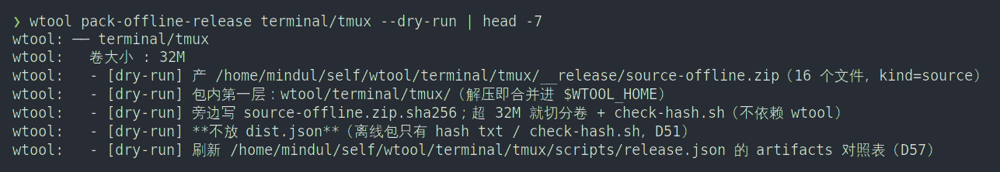

### wtool publish-offline-release

**功能**：把离线包上传到 `offline-<日期>` 那个 release 页。

**参数**：

| 参数 | 说明 |
|---|---|
| `<项目>...` / `each` | 逐项目上传 |
| `all` | 上传整机迁移包到 `wtool-doc` 的 release 页 |
| `--tag=<tag>` | 必须带 `offline`，默认 `offline-<今天>` |
| `--repo=<owner/name>` | 目标仓 |
| `--target=<sha>` | 指定 target commit |
| `--os-version=<版本>` | 整机包版本 |
| `--out=<目录>` | 整机包所在目录 |
| `--dry-run` | 只打印上传清单 |
| `--force` | 忽略检查 |
| `--allow-foreign` | 允许发到第三方仓 |

**运行结果**：

```text
$ wtool publish-offline-release shell/zsh --dry-run
wtool: ── shell/zsh
wtool:   目标仓 : allinkernel/wtool-zsh
wtool:   tag    : offline-2026-10-23（离线族；开发机那族是另一个 tag）
wtool:   - [dry-run] 上传 2 个文件 → allinkernel/wtool-zsh offline-2026-10-23
wtool:   - [dry-run] 资产（2 个）: release-offline.zip release-offline.zip.sha256
wtool:   - [dry-run] 之后把 offlineTag=offline-2026-10-23 写进 scripts/release.json（记得提交）
```

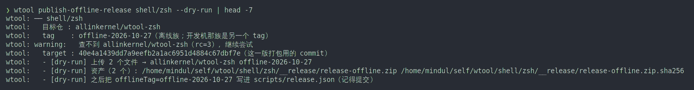

## 容器层

### wtool unpack-layer

**功能**：把 `__layer/<target>/` 里的层解成安装产物，写进 `__output/`。不联网、不要 docker。

**参数**：

| 参数 | 说明 |
|---|---|
| `<项目>` | 项目路径 |
| `--target=<目标>` | 只解某个发行版 |
| `--layer=<层名>` | 只解某一层 |
| `--output=<目录>` | 输出目录 |
| `--dry-run` | 只打印计划 |

**运行结果**：

```text
$ wtool unpack-layer shell/zsh --dry-run
wtool: ── shell/zsh  __layer/ubuntu_22.04/main → /home/you/self/wtool/shell/zsh/__output/ubuntu_22.04/
wtool:   - [dry-run] 读顶层 blob → payload/ + OWNED.tsv
```

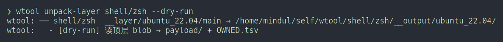

### wtool push-layer

**功能**：把 `__layer/<target>/` 里的层镜像推到镜像仓库。

**参数**：

| 参数 | 说明 |
|---|---|
| `<项目>...` | 项目路径 |
| `--registry=<前缀>` | 镜像仓库前缀，也可用 `$WTOOL_LAYER_REGISTRY` |
| `--target=<目标>` | 只推某个发行版 |
| `--layer=<层名>` | 只推某一层 |
| `--dry-run` | 只打印计划 |

**运行结果**：

```text
$ wtool push-layer shell/zsh --registry=registry.example.com/wtool --dry-run
wtool: ── shell/zsh  __layer/ubuntu_22.04/ → registry.example.com/wtool/zsh
wtool:   - [dry-run] main → registry.example.com/wtool/zsh:main-ubuntu_22.04
wtool: push-layer 完成（0 个项目）
```

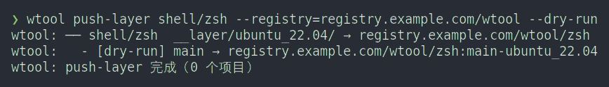

### wtool pull-layer

**功能**：从镜像仓库把层镜像拉到 `__layer/`。目标机不需要 docker。

**参数**：

| 参数 | 说明 |
|---|---|
| `<项目>...` | 项目路径 |
| `--registry=<前缀>` | 镜像仓库前缀，也可用 `$WTOOL_LAYER_REGISTRY` |
| `--target=<目标>` | 只拉某个发行版 |
| `--layer=<层名>` | 只拉某一层 |
| `--dry-run` | 只打印计划 |

**运行结果**：

```text
wtool: ── shell/zsh  ← registry.example.com/wtool/zsh:*-ubuntu_22.04
wtool: main（blob 只存一份；整个 layout 1.2G）
wtool: pull-layer 完成（1 个项目）—— 接着 wtool unpack-layer <项目>
```

仓库不存在、没登录时：

```text
wtool: error: 读不到 registry.example.com/wtool/zsh 的 tag 列表（仓库不存在？没登录？skopeo login <域名>）
```

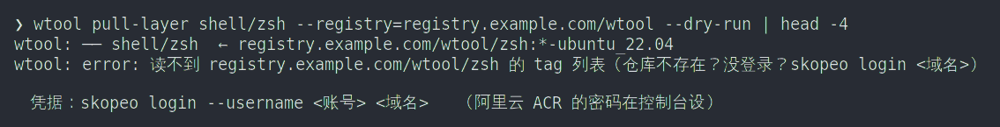

### wtool _layer-save

**功能**：把 docker 里的镜像存进项目的 `__layer/<target>/`。内部命令。

**参数**：

| 参数 | 说明 |
|---|---|
| `<项目>` | 项目路径 |
| `--image=<镜像>` | 必填 |
| `--target=<目标>` | 发行版；不给就从 `__output/` 推 |
| `--layer=<层名>` | 层名；不给就从镜像 tag 推 |

**运行结果**：

```text
wtool: error: 用法: wtool _layer-save <项目> --image=<镜像> [--target=<os_ver>] [--layer=<层名>]
```

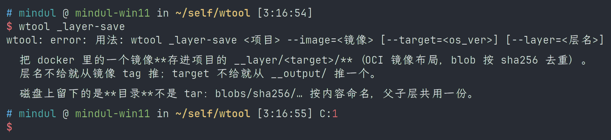

### wtool _layer-load

**功能**：把 `__layer/<target>/` 里的镜像装回 docker。内部命令。

**参数**：

| 参数 | 说明 |
|---|---|
| `<项目>` | 项目路径 |
| `--target=<目标>` | 发行版 |

**运行结果**：

```text
wtool: error: 用法: wtool _layer-load <项目> [--target=<os_ver>]
```

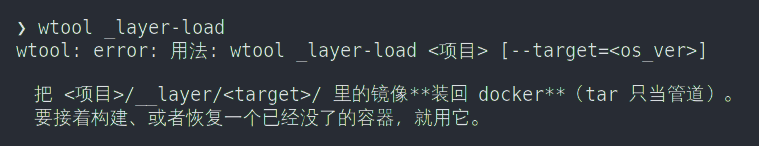

## repo 相关命令

这些函数由 `tools/git-repo-sh-tools` 提供，zsh 和 bash 同名。

### cs

**功能**：跳到 repo 工作区根目录。

**参数**：无。

**运行结果**：

```text
$ cd tools/git-repo-sh-tools
$ cs
$ pwd
/home/you/self/wtool
```

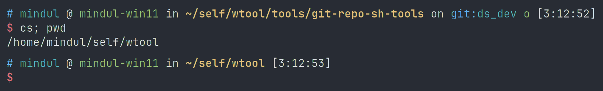

### css

**功能**：打印 repo 工作区根目录，不跳转。

**参数**：无。

**运行结果**：

```text
$ css
/home/you/self/wtool
```

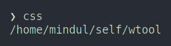

### ct

**功能**：跳到当前项目（最近的 `.git`）根目录。

**参数**：无。

**运行结果**：

```text
$ cd tools/git-repo-sh-tools/tests
$ ct
$ pwd
/home/you/self/wtool/tools/git-repo-sh-tools
```

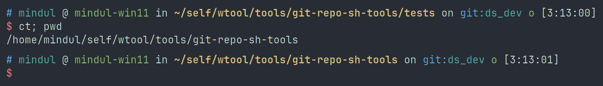

### ctt

**功能**：打印当前项目根目录，不跳转。

**参数**：无。

**运行结果**：

```text
$ ctt
/home/you/self/wtool/tools/git-repo-sh-tools
```

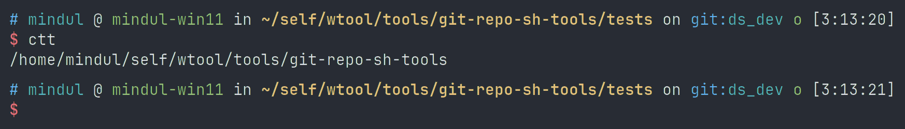

### cnp

**功能**：打印当前项目在清单里的相对路径。

**参数**：无。传参数会报错。

**运行结果**：

```text
$ cnp
tools/git-repo-sh-tools
```

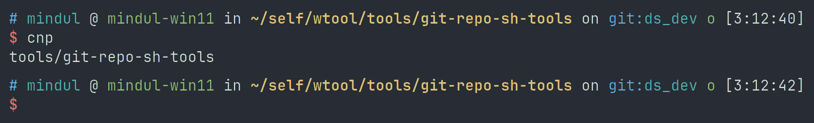

### cnn

**功能**：打印当前项目在清单里的仓库名。

**参数**：无。传参数会报错。

**运行结果**：

```text
$ cnn
allinkernel/wtool-repo.git
```

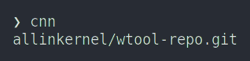

### cnb

**功能**：打印清单里给当前项目声明的分支。

**参数**：无。

**运行结果**：

```text
$ cnb
main
```

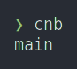

### cnr

**功能**：打印清单里给当前项目声明的 remote 名。

**参数**：无。

**运行结果**：

```text
$ cnr
github
```

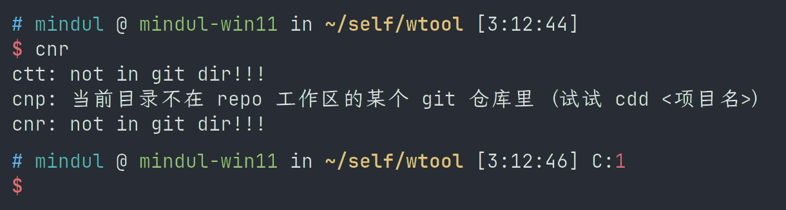

### cm

**功能**：跳到 `.repo/manifests`。

**参数**：无。

**运行结果**：

```text
$ cm
$ pwd
/home/you/self/wtool/.repo/manifests
```

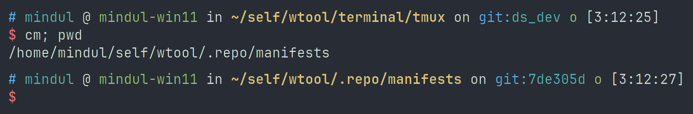

### cmm

**功能**：打印 `.repo/manifests` 路径。

**参数**：无。

**运行结果**：

```text
$ cmm
/home/you/self/wtool/.repo/manifests
```

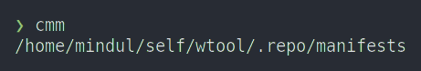

### cdd

**功能**：跳转：项目名、路径、现存文件/目录、gerrit 提交编号、一串点。

**参数**：

| 参数 | 说明 |
|---|---|
| `TARGET` | 只收一个。项目名 / 清单路径 / 现存路径 / `-N` 或 `N`（gerrit 编号）/ `..`、`...`（往上跳点数减一层） |

**运行结果**：

```text
$ cdd terminal/tmux
$ pwd
/home/you/self/wtool/terminal/tmux
```

```text
$ cdd -1234                  # 跳到 change 1234 所属项目
$ cdd ...                    # 往上跳两层
```

成功时无输出。找不到时：

```text
$ cdd no-such-project
cdd: 清单里没有 'no-such-project' 这个项目名或路径
     看看都有什么：/home/you/self/wtool/tools/git-repo-sh-tools/my_repo.py list --root /home/you/self/wtool
```

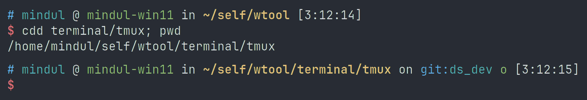
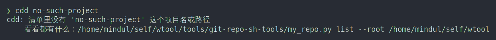
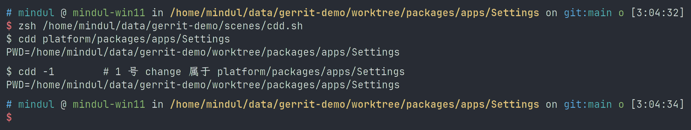
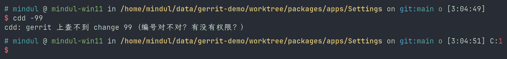

### cdd_path

**功能**：打印项目名对应的绝对路径，不跳转。

**参数**：

| 参数 | 说明 |
|---|---|
| `<项目名\|路径>` | 一个 |

**运行结果**：

```text
$ cdd_path terminal/tmux
/home/you/self/wtool/terminal/tmux
```

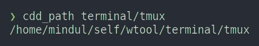

### rs

**功能**：生成当前清单快照，然后 `repo sync` 到这份快照。

**参数**：无。

**运行结果**：直接执行下面两条，输出就是 `repo` 的输出。

```text
repo manifest -o /tmp/tmp.XXXXXX.xml
repo sync -c -j32 --force-sync --force-checkout -d -m /tmp/tmp.XXXXXX.xml
```

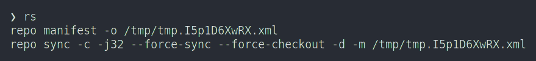

### rscur

**功能**：只同步当前目录所属的项目；不在项目根时同步该目录下的子项目。执行前询问。

**参数**：无。

**运行结果**：

```text
==>repo sync -c <项目>
total N repos in <相对路径>, execute it? ({ENTER/Y/y}/{N/n/*})
```


### wninja

**功能**：用当前项目的 `out/` 里的 ninja 文件跑 ninja。仅 zsh 可用。参数原样传给 ninja。

**参数**：

| 参数 | 说明 |
|---|---|
| `<ninja 参数>...` | 全部透传给 ninja |

**运行结果**：

```text
$ wninja
Error: No ninja build file found.
```


### gb

**功能**：打印当前项目可用的 push / pull / fetch 命令，以及 remote、branch。

**参数**：无。

**运行结果**：

```text
$ gb
git push github HEAD:refs/for/main
git push github HEAD:main
git pull github main --unshallow
git pull github main
git fetch github main --unshallow
git fetch github main
remote: github
branch: main
github	https://github.com/allinkernel/wtool-repo.git (fetch)
github	https://github.com/allinkernel/wtool-repo.git (push)
```


### gpun

**功能**：执行 `gb` 打印的 `git pull <remote> <branch> --unshallow`。

**参数**：

| 参数 | 说明 |
|---|---|
| 无 | 补全历史 |
| `-N` / `--depth=N` | 只拉 N 层，把 `--unshallow` 换成 `--depth=N` |

**运行结果**：

```text
$ gpun
gpun: 执行 git pull github main --unshallow
```

```text
$ gpun -30
gpun: 执行 git pull github main --depth=30
```


### gbb

**功能**：从 `gb` 的输出里挑直接 push 那条并执行。

**参数**：无。

**运行结果**：

```text
$ gbb
git push github HEAD:main
```


## gerrit 相关命令

服务器地址用环境变量或配置文件给：

```bash
export WTOOL_GERRIT_HOST=user@host:29418
```

```text
# <repo 根>/.gerrit/client.conf 或 ~/.wtool/gerrit.conf
host=gerrit.company.com
port=29418
user=yourname
sshkey=~/.ssh/id_rsa
```

### ggcp

**功能**：把 gerrit 上的提交抓回本地，切到对应项目，cherry-pick。

**参数**：

| 参数 | 说明 |
|---|---|
| `<编号>` | 一个或多个；逗号或空格分隔，如 `1234`、`1,2,3`、`1 2 3` |
| `<链接>` | `https://host/#/c/1234`、`https://host/c/proj/+/1234` |
| `<Change-Id>` | `I` 加 40 位十六进制；先查 gerrit，打表后逐个询问 |
| `1234/2` | 直接指定 patchset |
| `-p <n>` | 指定 patchset |
| `-y` / `--yes` | 全都打，不再问 |
| `-n` / `--no` | 全都跳过 |

**运行结果**：

```text
$ ggcp 1,2
1 个仓库 / 2 笔提交 / 成功 2 / 失败 0
项目名           项目路径  提交 id       patchset  结果说明
---------------  --------  ------------  --------  --------
platform/mylib   mylib     a1b2c3d4e5f6  1         成功
platform/mylib   mylib     b2c3d4e5f6a1  2         成功
```

同一 Change-Id 已在本地历史时，不抓、不打：

```text
此 Change-Id 已在本地历史（提交 a1b2c3d4e5f6，patchset 1）→ 先 ggrvt 1234 回退，再打 1234/2
```


### ggrvt

**功能**：把本地历史里同 Change-Id 的提交 revert 掉。只改本地。

**参数**：

| 参数 | 说明 |
|---|---|
| `<编号>` | gerrit change 编号 |
| `<链接>` | gerrit 链接 |
| `<Change-Id>` | `I` 加 40 位十六进制 |

不接受 patchset：`ggrvt 1234/2` 报错。

**运行结果**：

```text
$ ggrvt 1234
已回退 a1b2c3d4e5f6（change 1234, patchset 2）→ 现在可以 ggcp 1234/2
```


### gchk

**功能**：查一个 change 有没有 +2、有没有 merged。

**参数**：

| 参数 | 说明 |
|---|---|
| `<change>` | 编号、链接或 Change-Id |

退出码：0 = 已 merged，1 = 还没，2 = 查不到。

**运行结果**：

```text
$ gchk 1234
change 1234  [NEW]
  project : platform/mylib
  branch  : main
  subject : lab: change one (ps1)
  patchset: 2  a1b2c3d4e5f6
  投票    : Code-Review +2 by alice
  链接    : https://gerrit.example.com/c/platform/mylib/+/1234
  => 已 +2（来自 alice），但还没 merged
```


### gq

**功能**：列出一个 change 的摘要。

**参数**：

| 参数 | 说明 |
|---|---|
| `<change>` | 编号、链接或 Change-Id |
| `-r` / `--raw` | 输出原始 JSON |

**运行结果**：

```text
$ gq 1234
1234	NEW	platform/mylib	lab: change one
```


### gpush

**功能**：把当前 HEAD 推到 `refs/for/<清单声明的分支>`。

**参数**：

| 参数 | 说明 |
|---|---|
| `[remote]` | 默认 `polygerrit` |
| `[额外参数]...` | 透传给 `git push` |

**运行结果**：

```text
$ gpush
gpush: git push polygerrit HEAD:refs/for/main
```


### ggco

**功能**：从远端抓一个分支 / tag / commit，然后切过去。

**参数**：

| 参数 | 说明 |
|---|---|
| `<分支\|tag\|commit>` | 一个，不能以 `-` 开头 |

工作树有本地改动时拒绝执行。

**运行结果**：

```text
$ ggco main
ggco: /home/you/self/wtool/tools/git-repo-sh-tools 现在在 main @ 1a2b3c4（来自 github main）
```


## shell 集成与别名

这些别名和函数由 `shell/shell-rc` 提供。

### 别名

**功能**：常用命令缩写。

**参数**：无。

| 别名 | 实际命令 |
|---|---|
| `gs` | `git status` |
| `gss` | `git status --short` |
| `gd` | `git diff` |
| `gds` | `git diff --staged` |
| `gll` | `git log` |
| `gl` | `git log` |
| `s` | `ls` |
| `sl` | `ls` |
| `lks` | `ls` |
| `kls` | `ls` |


### cw

**功能**：跳到含 `.repo` 的工作区根。

**参数**：无。

**运行结果**：

```text
$ cw
$ pwd
/home/you/self/wtool
```


### gba

**功能**：`git branch -a`，有 `batcat` 时用 `batcat` 分页。

**参数**：无。

**运行结果**：

```text
$ gba
* ds_dev
  main
  remotes/github/ds_dev
  remotes/github/main
  remotes/m/wtool -> github/main
```


### pwd

**功能**：打印当前目录，同时记到 `/tmp/wsw-temp-pwd-id-<uid>`。

**参数**：无。

**运行结果**：

```text
$ cd /tmp
$ pwd
/tmp
```


### pdd

**功能**：回到 `pwd` 上次记下的目录。

**参数**：无。

**运行结果**：

```text
$ pdd
$ pwd
/tmp
```


### pss

**功能**：打印 `pwd` 上次记下的目录。

**参数**：无。

**运行结果**：

```text
$ pss
/tmp
```


### this_is_wsl

**功能**：判断是不是 WSL。WSL 上 rc=0。

**参数**：无。

**运行结果**：

```text
$ this_is_wsl; echo $?
0
```


### this_is_not_wsl

**功能**：判断是不是非 WSL。非 WSL 上 rc=0。

**参数**：无。

**运行结果**：

```text
$ this_is_not_wsl; echo $?
1
```


### win

**功能**：把当前目录或给定路径翻译成 mac / Windows / scp / WSL / Linux 可用的路径，打一张表。

**参数**：

| 参数 | 说明 |
|---|---|
| 无 | 用当前目录 |
| `<路径>` | 用给定路径 |

没有 `WIN_IP` 时对应行显示「请设置 WIN_IP」。

**运行结果**：

```text
$ win
usage  path
mac    请设置 WIN_IP
win    请设置 WIN_IP
scp    请设置 WIN_IP
wsl    \\wsl.localhost\mindul-ubuntu14\tmp
linux  请设置 WIN_IP
```


### start

**功能**：在 Windows 侧打开文件、目录或程序。仅 WSL。

**参数**：

| 参数 | 说明 |
|---|---|
| `<路径\|程序名>` | 路径会先解析软链；裸词原样交给 Windows |

**运行结果**：

```text
$ start /no/such/path
start: 路径不存在：/no/such/path
```

非 WSL：

```text
$ start .
only wsl support this
```


### proxy_on

**功能**：导出 `http_proxy` / `https_proxy` / `all_proxy` 及其大写变量，并补 `no_proxy`。

**参数**：

| 参数 | 说明 |
|---|---|
| `<IP>` | 不给就用 `$PROXY_IP`；非交互时必填 |
| `[端口]` | 不给就用 `$PROXY_PORT`，默认 7897 |

**运行结果**：

```text
$ proxy_on 127.0.0.1 7897
Proxy ON  http://127.0.0.1:7897  (all_proxy=socks5://127.0.0.1:7897)
          no_proxy=localhost,127.0.0.1,::1,.local
```


### proxy_off

**功能**：清除代理变量，恢复原来的 `no_proxy`。

**参数**：无。

**运行结果**：

```text
$ proxy_off
Proxy OFF（代理变量已清除；PROXY_IP/PROXY_PORT 留着，下次 proxy_on 不用再问）
```


### wrg

**功能**：按构建目标名搜索 `Android.bp`、`Android.mk` 和 Makefile。

**参数**：

| 参数 | 说明 |
|---|---|
| `<名字>` | 精确匹配目标名 |
| `-i` / `--ignore-case` | 去 `_` 后按子串模糊匹配 |
| `-e <名字>` | 多名字查询，可重复 |
| `-t bp\|mk\|make` | 只搜某类文件 |
| `-A/-B/-C <n>` | 上下文行数 |
| `-l` / `--files` | 只打印文件路径 |
| `-c` / `--count` | 打印每个文件的命中条数 |
| `-m <n>` | 全局最多输出 n 条 |
| `--color[=WHEN]` | `auto` / `always` / `never` |
| `-v` / `--version` | 版本和搜索后端 |

环境变量：`WRG_SEARCH=auto|rg|fd|find`、`WRG_COLOR=auto|always|never`、`NO_COLOR`。

**运行结果**：

```text
$ wrg -v
wrg 1.0（后端 rg）
```


### oh-my-zsh

**功能**：加载 oh-my-zsh，主题 `ys`，插件 `git`。

**参数**：无。

**运行结果**：交互式 zsh 里提示符为主题 `ys` 的样式。

```text
ZSH_THEME="ys"
plugins=(git)
source $ZSH/oh-my-zsh.sh
```


### z

**功能**：zoxide 的跳目录函数。

**参数**：

| 参数 | 说明 |
|---|---|
| `<目录片段>` | 跳到匹配度最高的目录 |

**运行结果**：

```text
$ z wtool && pwd
/home/you/self/wtool
```


### zi

**功能**：zoxide 的交互式选择目录函数。

**参数**：

| 参数 | 说明 |
|---|---|
| `<目录片段>` | 可选，先按片段过滤 |

**运行结果**：

```text
$ zi
```

打开 fzf 选择目录，回车后跳过去。


### fzf-history-widget

**功能**：zsh 的 fzf 历史搜索 widget，绑在 `Ctrl-R`。

**参数**：无。

**运行结果**：

```text
$ bindkey '^R'
"^R" fzf-history-widget
```


### fzf-file-widget

**功能**：fzf 的文件选择 widget，zsh 绑在 `Ctrl-T`，bash 也绑在 `Ctrl-T`。

**参数**：无。

**运行结果**：

```text
$ bindkey '^T'
"^T" fzf-file-widget
```


### fzf-cd-widget

**功能**：fzf 的目录选择 widget，zsh 绑在 `Alt-C`（`^[c`）。

**参数**：无。

**运行结果**：

```text
$ bindkey '^[c'
"^[c" fzf-cd-widget
```


### fzf-completion

**功能**：fzf 的补全 widget，zsh 绑在 `Tab`（`^I`）。

**参数**：无。

**运行结果**：

```text
$ bindkey '^I'
"^I" fzf-completion
```


### tmux-wtool

**功能**：用项目自己的 `tmux.conf` 启动 tmux。

**参数**：`tmux` 自己的参数原样传入。

**运行结果**：

```text
$ alias tmux-wtool
alias tmux-wtool='command tmux -f "$WTOOL_TMUX_DIR/tmux.conf"'
```


### 内部辅助函数

这些函数会被别的函数调用，一般不直接敲。

| 函数 | 用途 |
|---|---|
| `repo_mfst_get_name_from_path` | 清单路径 → 仓库名 |
| `repo_mfst_get_path_from_name` | 仓库名 → 清单路径 |
| `repo_mfst_get_branch_from_path` | 清单路径 → 分支 |
| `repo_mfst_get_branch_from_name` | 仓库名 → 分支 |
| `repo_mfst_get_remote_from_name` | 仓库名 → remote |
| `repo_mfst_get_remote_from_path` | 清单路径 → remote |
| `repo_mfst_get_url_from_name` | 仓库名 → clone URL |
| `wt_os_detect` | 探测系统 / 架构 / 并行度 |
| `prompt_starship_precmd` | zsh starship 提示符钩子 |
| `prompt_starship_preexec` | zsh starship 提示符钩子 |
| `starship_zle-keymap-select` | zsh starship 键位切换钩子 |
| `starship_precmd` | bash starship 提示符钩子 |
| `starship_preexec` | bash starship 提示符钩子 |
| `starship_preexec_ps0` | bash starship 提示符钩子 |

## 键盘与历史搜索

| 键 | zsh | bash |
|---|---|---|
| `↑` / `↓` | 原生历史，不弹选择器 | 原生历史，不弹选择器 |
| `Ctrl-R` | fzf 历史搜索 | fzf 历史搜索 |
| `Ctrl-P` | 原生 `up-line-or-history`，等同 `↑` | fzf 历史搜索，等同 `Ctrl-R` |

### ↑ / ↓

**功能**：上一条 / 下一条历史命令。zsh 和 bash 都是原生行为。

**参数**：无。

**运行结果**：

```text
$ git status
$ ↑
$ git status
```

命令行出现上一条命令，不弹选择器。


### Ctrl-R

**功能**：在命令历史里搜索。zsh 用 `fzf-history-widget`，bash 用 `__fzf_history__`。

**参数**：无。打开后直接输入关键字过滤。

**运行结果**：

```text
  HIST_ALPHA_OUT
  HIST_BETA_BUILD
> HIST_GAMMA_RUN
  3/12
```

回车选中后，命令只是被填到命令行，不执行：

```text
$ HIST_GAMMA_RUN
```

可以继续编辑，再回车执行。


### Ctrl-P

**功能**：zsh 里等同 `↑`；bash 里等同 `Ctrl-R` 的 fzf 历史搜索。

**参数**：无。bash 里打开后直接输入关键字过滤。

**运行结果**：

zsh：

```text
$ git status
$ Ctrl-P
$ git status
```

bash：

```text
  HIST_ALPHA_OUT
  HIST_BETA_BUILD
> HIST_GAMMA_RUN
  3/12
```

选中回车后同样只填到命令行，不执行。


### Ctrl-T

**功能**：fzf 选文件，把路径填到命令行。zsh 用 `fzf-file-widget`，bash 用 `fzf-file-widget`。

**参数**：无。打开后输入关键字过滤。

**运行结果**：

```text
$ bindkey '^T'
"^T" fzf-file-widget
```

选中回车后路径填到命令行，不执行。


### Alt-C

**功能**：fzf 选目录并跳过去。zsh 用 `fzf-cd-widget`。

**参数**：无。

**运行结果**：

```text
$ bindkey '^[c'
"^[c" fzf-cd-widget
```


### Ctrl-G

**功能**：打开 navi 命令速查。zsh 绑成 `_navi_widget`。

**参数**：无。打开后输入关键字过滤。

**运行结果**：

```text
$ bindkey '^G'
"^G" _navi_widget
```


### tmux 前缀键

**功能**：tmux 默认前缀是 `Ctrl-B`。先按前缀，再按命令键。

**参数**：无。

**运行结果**：

```text
$ tmux show-options -g prefix
prefix C-b
```

常用键：`prefix + h/j/k/l` 切 pane（配置里另有 `Alt-h/j/k/l`），`prefix + Space` 已解绑。


## tmux 状态栏

### tmux

**功能**：包装 `tmux`，固定使用 `terminal/tmux/tmux.conf`。

**参数**：`tmux` 自己的参数原样传入。

**运行结果**：

```text
$ tmux -V
tmux 3.4
```


### cpu.sh

**功能**：状态栏 CPU 指示。

**参数**：

| 参数 | 说明 |
|---|---|
| `<loadavg 文件>` | 可选，默认 `/proc/loadavg` |
| `$WTOOL_NCPU` | 可选，指定在线 CPU 数 |

**运行结果**：

```text
$ sh ~/.wtool/wtool/terminal/tmux/bin/cpu.sh
[C:0%]
```


### mem.sh

**功能**：状态栏可用内存和可用 swap。

**参数**：

| 参数 | 说明 |
|---|---|
| `<meminfo 文件>` | 可选，默认 `/proc/meminfo` |

**运行结果**：

```text
$ sh ~/.wtool/wtool/terminal/tmux/bin/mem.sh
[M:19.5G S:68.7G]
```

读不到 `/proc/meminfo` 时输出 `[M:? S:?]`。


### disk.sh

**功能**：状态栏磁盘使用量。

**参数**：无。

**运行结果**：

```text
$ sh ~/.wtool/wtool/terminal/tmux/bin/disk.sh
[/dev/sdd:288.5G C:\18.5G D:\262.4G E:\1.2T]
```

没有识别到磁盘时输出 `[]`。


## musl 工具（43 个）

### 工具总表

每个工具一个项目，装单个：

```bash
wtool install tools/musl-bins/bat
```

| 命令 | 工具目录 | 功能 | 典型用法 |
|---|---|---|---|
| `bat` | `bat` | 带语法高亮的 cat | `bat file` |
| `eza` | `eza` | ls 替代 | `eza -l` |
| `delta` | `delta` | git diff 高亮 | `git diff \ |
| `dust` | `dust` | 磁盘占用树 | `dust` |
| `duf` | `duf` | 磁盘使用概览 | `duf` |
| `procs` | `procs` | 进程查看 | `procs` |
| `btm` | `bottom` | 系统监控 | `btm` |
| `jq` | `jq` | JSON 处理 | `jq . file.json` |
| `gojq` | `gojq` | JSON 查询 | `gojq . file.json` |
| `yq` | `yq` | YAML / JSON 处理 | `yq '.a' file.yaml` |
| `sd` | `sd` | 查找替换 | `sd old new file` |
| `hyperfine` | `hyperfine` | 命令基准测试 | `hyperfine 'cmd'` |
| `just` | `just` | 命令运行器 | `just` |
| `scc` | `scc` | 代码行数统计 | `scc` |
| `difft` | `difftastic` | 语法感知 diff | `difft a.c b.c` |
| `fclones` | `fclones` | 重复文件查找 | `fclones group .` |
| `shellcheck` | `shellcheck` | shell 脚本检查 | `shellcheck x.sh` |
| `shfmt` | `shfmt` | shell 格式化 | `shfmt -w x.sh` |
| `age` | `age` | 文件加密 | `age -e -r <公钥> file` |
| `b3sum` | `b3sum` | BLAKE3 校验 | `b3sum file` |
| `glow` | `glow` | Markdown 终端渲染 | `glow README.md` |
| `xh` | `xh` | HTTP 客户端 | `xh GET https://example.com` |
| `gping` | `gping` | 图形化 ping | `gping host` |
| `trip` | `trippy` | 网络诊断 | `sudo trip example.com` |
| `yazi` | `yazi` | 终端文件管理器 | `yazi` |
| `zellij` | `zellij` | 终端复用器 | `zellij` |
| `lazygit` | `lazygit` | Git TUI | `lazygit` |
| `dive` | `dive` | 镜像层分析 | `dive image:tag` |
| `fzf` | `fzf` | 模糊查找 | `fzf` |
| `zoxide` | `zoxide` | 智能 cd | `zoxide query proj` |
| `direnv` | `direnv` | 目录级环境变量 | `direnv allow` |
| `starship` | `starship` | 提示符 | `starship init zsh` |
| `navi` | `navi` | 命令速查 | `navi` |
| `rclone` | `rclone` | 云存储同步 | `rclone sync src remote:dst` |
| `mlr` | `miller` | CSV / JSON 处理 | `mlr --icsv --ojson cat data.csv` |
| `csvlens` | `csvlens` | CSV 查看 | `csvlens data.csv` |
| `watchexec` | `watchexec` | 文件变化时执行命令 | `watchexec -e py pytest` |
| `lf` | `lf` | 终端文件管理器 | `lf` |
| `micro` | `micro` | 终端编辑器 | `micro file` |
| `hexyl` | `hexyl` | 十六进制查看 | `hexyl file` |
| `qsv` | `qsv` | CSV 处理 | `qsv stats data.csv` |
| `rg` | `ripgrep` | 递归搜索 | `rg pattern` |
| `fdfind` | `fdfind` | find 替代 | `fdfind pattern` |

### 工具截图

| 命令 | 截图 | 命令 | 截图 |
|---|---|---|---|
| `bat` |  | `eza` |  |
| `delta` |  | `dust` |  |
| `duf` |  | `procs` |  |
| `btm` |  | `jq` |  |
| `gojq` |  | `yq` |  |
| `sd` |  | `hyperfine` |  |
| `just` |  | `scc` |  |
| `difft` |  | `fclones` |  |
| `shellcheck` |  | `shfmt` |  |
| `age` |  | `b3sum` |  |
| `glow` |  | `xh` |  |
| `gping` |  | `trip` |  |
| `yazi` |  | `zellij` |  |
| `lazygit` |  | `dive` |  |
| `fzf` |  | `zoxide` |  |
| `direnv` |  | `starship` |  |
| `navi` |  | `rclone` |  |
| `mlr` |  | `csvlens` |  |
| `watchexec` |  | `lf` |  |
| `micro` |  | `hexyl` |  |
| `qsv` |  | `rg` |  |
| `fdfind` |  | | |


## 其它命令（`$WTOOL_HOME/usr/bin`）

### zsh

**功能**：wtool 装的 zsh。

**参数**：zsh 自己的参数原样传入。

**运行结果**：

```text
$ zsh --version
zsh 5.9.2 (x86_64-unknown-linux-gnu)
```


### wpack

**功能**：Android 镜像解包 / 打包。

**参数**：

| 参数 | 说明 |
|---|---|
| `unpack <项目>/<类型> <镜像> <工作目录>` | 解包 |
| `repack <项目>/<类型> <工作目录> <输出镜像>` | 重新打包 |
| `restore <项目>/<类型> <工作目录> <路径>` | 还原一个叶子 |
| `list [项目]` | 列项目 / 类型 |
| `doctor` | 自检 |

**运行结果**：

```text
$ wpack --version
wpack 0.1.0
```


### dsh-remote

**功能**：手机远程查看 / 接管 DSH 会话。

**参数**：

| 参数 | 说明 |
|---|---|
| `status` | 体检：harness、隧道、推送、手机地址 |
| `serve` | 后台起 harness |
| `tunnel` / `tunnel-install` / `tunnel-uninstall` / `tunnel-status` | 反向隧道 |
| `serve-install` / `serve-status` / `serve-uninstall` | dsh web 常驻服务 |
| `broker-install` / `broker-uninstall` | token broker 常驻服务 |
| `force-restart-dsh-remote` | 重启隧道 / broker 并复验 |
| `url` | 打印手机地址 |
| `notify-test` / `notify-enable` / `notify-disable` | 推送开关 |
| `passwd` | 改中继密码 |
| `server` | 一条命令装好云上 + 家里 |
| `cloud-install` / `cloud-setup` | 阿里云侧 |
| `migrate` / `check-hooks` / `log` | 迁移 / 验证钩子 / 日志 |

**运行结果**：

```text
$ dsh-remote status
dsh-remote: …（按实际配置打印体检结果）
```


### dsh-notify

**功能**：把消息推到手机或邮箱。

**参数**：

| 参数 | 说明 |
|---|---|
| `<标题> <正文>` | 直接推一条 |
| `--test` | 推测试消息 |
| `--test --provider graph` | 只测 Graph |
| `--hook [--async]` | 从 stdin 读 hook JSON |

**运行结果**：

```text
$ dsh-notify --test
dsh-notify: 已发送（provider=…）
```


### dsh-token-broker

**功能**：把手机访问的 `/` 302 到当前 dsh web token。

**参数**：

| 参数 | 说明 |
|---|---|
| `--host <地址>` | 绑定地址，默认 `127.0.0.1` |
| `--port <端口>` | 监听端口，默认 3081 |
| `--web-port <端口>` | dsh web 端口，默认 3080 |
| `--token-file <文件>` | token 文件 |
| `--probe-timeout <秒>` | 探测超时，默认 3 |

**运行结果**：

```text
$ dsh-token-broker --help
usage: dsh-token-broker [-h] [--host HOST] [--port PORT] …
```


### dsh-remote-server

**功能**：`dsh-remote server` 的别名。

**参数**：与 `dsh-remote server` 相同。

**运行结果**：

```text
$ dsh-remote-server --help
server 不认识的参数：--help（dsh-remote help）
```


### 其它 `usr/bin` 命令

| 命令 | 用途 |
|---|---|
| `zsh-5.9.2` | 带版本号的 zsh 二进制 |
| `dsh-qr` | 把文本画成二维码 |
| `dsh-notify-graph-setup` | 一次性授权 Microsoft Graph，写 `notify.conf` |
| `dsh-web-run` | `dsh web` 的常驻包装（systemd 用） |
| `harness-remote` | 云上那半的管理器：隧道 / broker / 公网入口 |
| `dsh-force-restart-dsh-remote` | `dsh-remote force-restart-dsh-remote` 的薄封装 |


## 常见问题

### `wtool` 命令找不到

```bash
exec $SHELL
```

还不行就看 rc 末尾有没有这两行：

```bash
export WTOOL_HOME=~/.wtool
source ${WTOOL_HOME}/env.zsh
```

### `wtool check` 退出码是 0，但项目没装

```bash
wtool status
```

`wtool check` rc=0 只表示声明、账本、磁盘一致。

### `wtool check` 报对不上

```bash
wtool repair <项目>
wtool uninstall <旧路径> --no-script
wtool install <项目>
```

### 按 Tab 补出来的是文件名

```bash
exec $SHELL
```

还不行：

```bash
wtool install wtool-base-tools --force
exec $SHELL
```

### 没有 sudo

跳过 `sudo-*`，其余照常：

```bash
./install.sh
exec $SHELL
wtool bootstrap
```

### 删掉 `~/.wtool`

```bash
wtool uninstall all
wtool kill-self-forever
```

### `env -i` 下 zsh 动态模块加载不到

```bash
env -i ZDOTDIR=~/.wtool zsh
```

### `wtool install` 报「不是 git 仓库」

```bash
wtool install <项目> --force
```

### 项目里是 `output/` 而不是 `__output/`

```bash
cd <项目目录>
mv output __output
mv release __release
mv layer __layer
```

### `install.sh` 装包时看起来卡住

每 5 秒会打印一行进度：

```text
wtool-install:     还在装…（30 秒）  · Get:3 http://… 45.2 MB/120 MB
```

有这行就还在跑。
