# 工具与环境命令手册

这一页是**装进来的工具和环境**提供的命令；`wtool` 命令本身见 [wtool.md](wtool.md)，
dsh 那组见 [dsh-tutorial.md](dsh-tutorial.md)，安装见 [install.md](install.md)。

每条命令只写：功能、最常用的几条用法、一张真终端截图。

## repo 相关命令

这些函数由 `tools/git-repo-sh-tools` 提供，zsh 和 bash 同名。

### cs

**功能**：跳到 repo 工作区根目录。

```sh
cs                      # 任意子目录里都能跳回工作区根
cs && pwd               # 确认落到哪
```

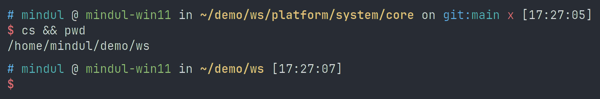

### css

**功能**：打印 repo 工作区根目录，不跳转。

```sh
css
```


### ct

**功能**：跳到当前项目（最近的 `.git`）根目录。

```sh
ct                      # 在 tools/x/src 里跳到 tools/x
```


### ctt

**功能**：打印当前项目根目录，不跳转。

```sh
ctt
```


### cnp

**功能**：打印当前项目在清单里的相对路径。

```sh
cnp                     # 如 tools/git-repo-sh-tools
```

**提示**：传参数会报错 —— 它只认"当前目录属于哪个项目"。


### cnn

**功能**：打印清单里当前项目的仓库名。

```sh
cnn                     # 如 allinkernel/wtool-repo.git
```

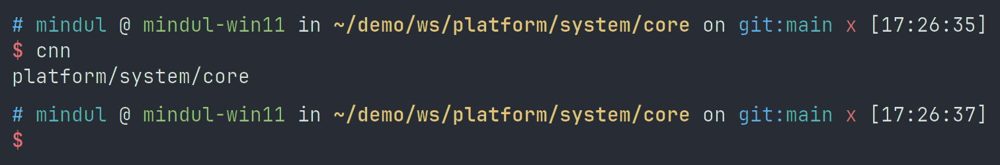

### cnb

**功能**：打印清单里当前项目的分支。

```sh
cnb                     # 如 main
```


### cnr

**功能**：打印清单里当前项目的 remote 名。

```sh
cnr                     # 如 github
```


### cm

**功能**：跳到 `.repo/manifests`。

```sh
cm && pwd
```


### cmm

**功能**：打印 `.repo/manifests` 的路径，不跳转。

```sh
cmm
```


### cdd

**功能**：跳到某个项目；`-<编号>` 直接跳到某个 gerrit change 所属的项目。

**常用**：
```sh
cdd platform/system/core    # 按项目名/路径跳
cdd -2                      # 跳到 change 2 所属的项目
cdd no-such-project         # 找不到时给出提示
```

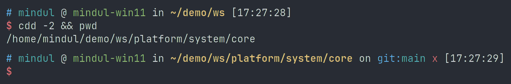
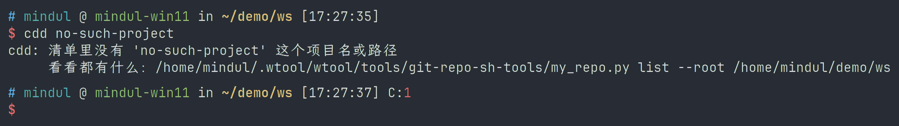

### cdd_path

**功能**：只打印项目路径，不跳转。

```sh
cdd_path terminal/tmux
```


### rs

**功能**：生成当前清单快照，再 `repo sync` 到这份快照。

```sh
rs                      # 等价于 repo manifest -o /tmp/tmp.XXX.xml + repo sync -c … -m 那份
```

**注意**：这条**真的会跑 `repo sync --force-sync`**（按清单重写工作区里的项目）。
本页不给它截图 —— 截图那次就是真跑了，把 repo 客户端就地重写过一次
（教训见 `harness/docs/hazards.md` H39）。

### rscur

**功能**：同上，但先用当前清单（不走快照），并让你确认一次。

```sh
rscur                   # 回车/Y 执行，N/其它 退出
printf 'n\n' | rscur    # 非交互：直接不执行
```

**注意**：同上，真的会跑 `repo sync`，不截图。

### wninja

**功能**：在 Android 源码树里用 `ninja` 增量编译（带 `-j` 和常用参数）。

```sh
wninja                  # 在 Android 源码树里增量编译
```

**注意**：这条会**真的调 `ninja` 构建**（改 `out/`），本页不截图。

### gb

**功能**：打印当前项目的 remote / 分支，以及对应的 push、pull、fetch 命令。

```sh
gb
```

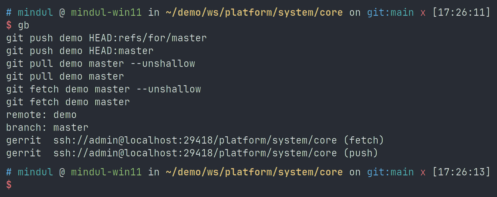

### gpun

**功能**：用 `gb` 给出的 `git pull <remote> <branch>` 把历史补下来（浅克隆变完整 / 只取最近 N 条）。

**用法**：`gpun [<深度> | --depth=<深度>]`

| 参数 | 说明 |
|---|---|
| 不带参数 | 执行 `git pull <remote> <branch> --unshallow`，把浅克隆补成完整历史 |
| `-30` | 换成 `--depth=30`，只取最近 30 条 |
| `--depth=30` | 同上（等价写法） |

**常用**：
```sh
gpun              # 补全历史（浅克隆 → 完整）
gpun -30          # 只要最近 30 条
gpun --depth=100  # 最近 100 条
```

**注意**：仓库本来就不是浅克隆时，`gpun` 会报 `--unshallow on a complete repository does not make sense` —— 这是 git 的正常拒绝，换 `gpun -30` 即可。

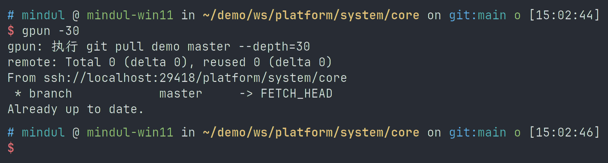
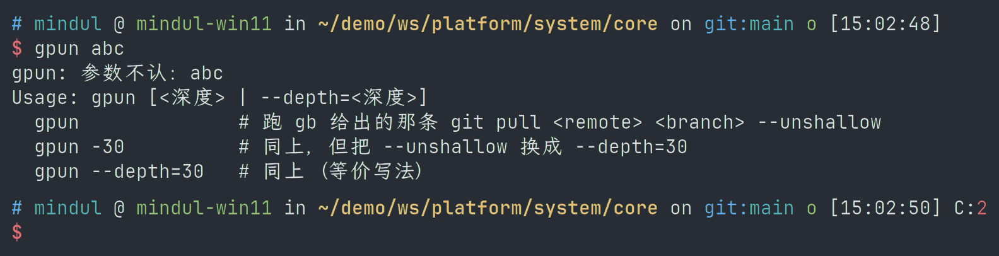

### gbb

**功能**：只打印 push / pull / fetch 那几条命令，不执行。

```sh
gbb
```


## gerrit 相关命令

服务器地址用环境变量或配置文件给（`<repo 根>/.gerrit/client.conf` 或 `~/.wtool/gerrit.conf`）：

```sh
export WTOOL_GERRIT_HOST=user@host:29418
```

本页这几张图是对着一台**真 gerrit 服务器**（`http://127.0.0.1:8080`，ssh 29418）和盘上
**真 AOSP 12 `packages/apps/Settings`** 跑的，change 1 / 2（ps1、ps2）/ 3 都是真提交。

### ggcp

**功能**：把 gerrit 上的 patchset 打到本地（自动切到对应项目再 cherry-pick）。

**常用**：
```sh
ggcp 2              # 打 change 2 的最新 patchset
ggcp 2/2            # 指定 patchset 2
ggcp 1,3            # 一次打多笔
ggcp -y 1 3         # 全都打，不逐笔确认
```

同 Change-Id 已在本地历史时会拦下，并提示先 `ggrvt` 回退。

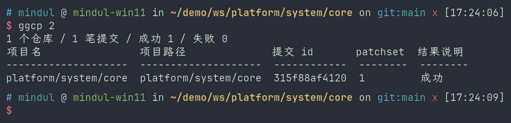
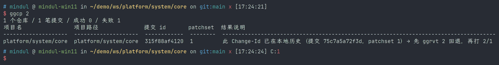
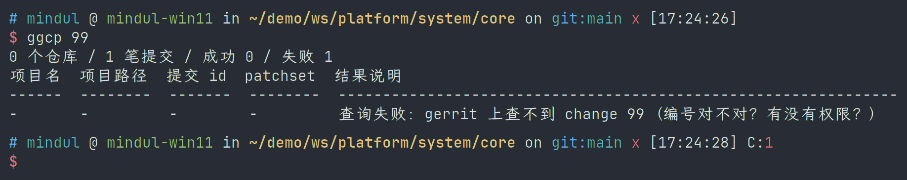

### ggrvt

**功能**：把本地历史里同 Change-Id 的提交 revert 掉（只改本地）。

**常用**：
```sh
ggrvt 2             # 回退 change 2 打上的那一笔
ggcp 2/2            # 然后就能打新 patchset
```

本地没有该 Change-Id 时会提示先 `ggcp`。

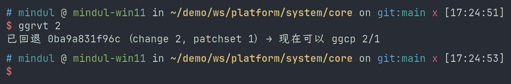
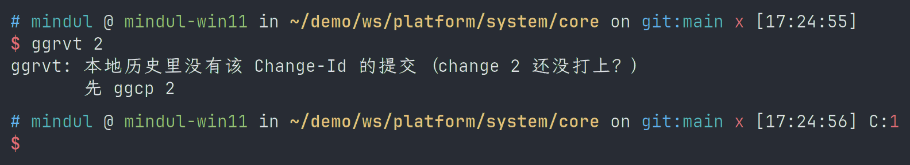

### gchk

**功能**：查一个 change 有没有 +2 / 有没有合入（退出码：0 已合入，1 未合入，2 查不到）。

**常用**：
```sh
gchk 2              # 查 change 2
```

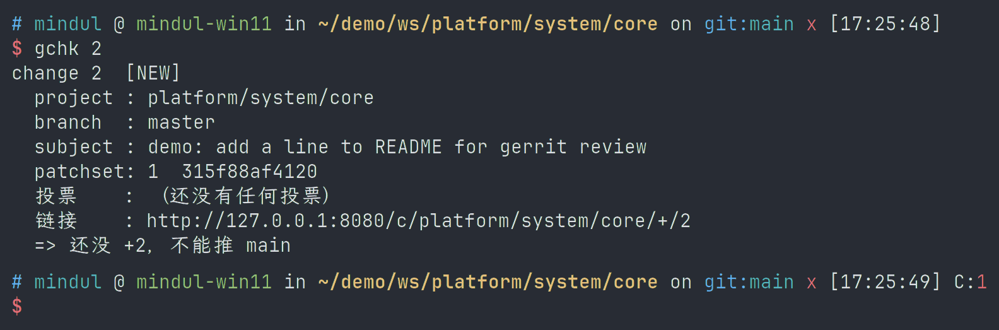

### gq

**功能**：查一个 change 的摘要（编号 / 状态 / 项目 / 主题）。

**常用**：
```sh
gq 2                # 查 change 2
gq 2 -r             # 输出原始 JSON
```

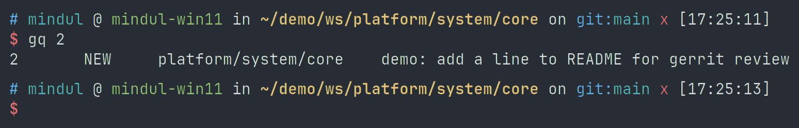

### gpush

**功能**：把当前 HEAD 推到 `refs/for/<清单里声明的分支>`（送 gerrit 检视）。

**用法**：`gpush [remote] [额外参数...]`

| 参数 | 说明 |
|---|---|
| `remote` | 推到哪个 remote，默认 `polygerrit`；仓库没有它时报错并列出现有 remote |
| 额外参数 | 原样透传给 `git push`（如 `-o skip-validation`、`-f`、`--no-thin`） |

**常用**：
```sh
gpush                             # 用默认 remote（polygerrit）
gpush gerrit                      # 换成本仓库实际的 remote 名
gpush gerrit -o skip-validation   # 额外参数透传
```

**注意**：目标分支取自清单（`cnb`），不是当前分支；提交里必须有 `Change-Id`，否则被 gerrit 拒绝。

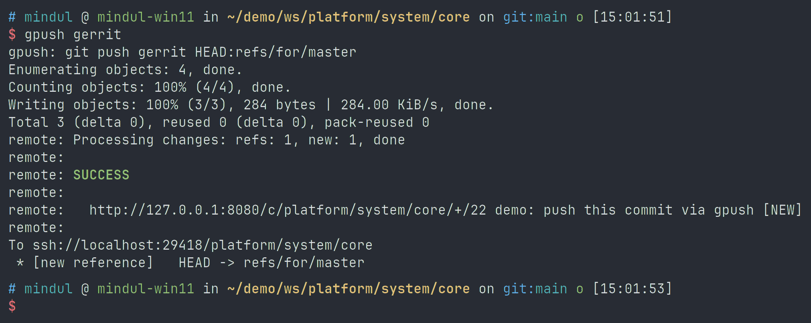
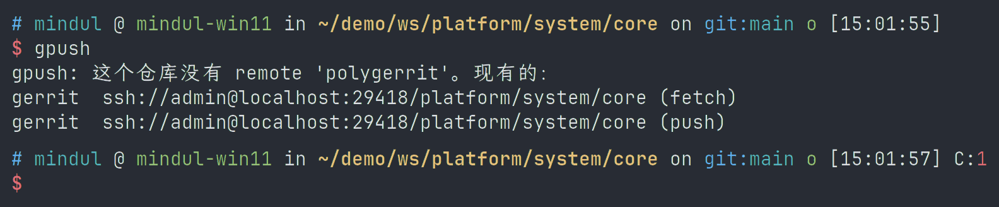

### ggco

**功能**：从远端抓一个分支 / tag / commit，然后切过去。

```sh
ggco main                 # 抓远端 main 再切
```

**提示**：工作树有本地改动时拒绝执行。


## shell 集成与别名

这些别名和函数由 `shell/shell-rc` 提供。

### 别名

**功能**：常用命令缩写。

| 别名 | 实际命令 |
|---|---|
| `gs` | `git status` |
| `gss` | `git status --short` |
| `gd` | `git diff` |
| `gds` | `git diff --staged` |
| `gll` | `git log` |
| `gl` | `git log` |
| `s` | `ls` |
| `sl` | `ls` |
| `lks` | `ls` |
| `kls` | `ls` |


### cw

**功能**：跳到含 `.repo` 的工作区根。

```sh
cw && pwd
```


### gba

**功能**：`git branch -a`，有 `batcat` 时用 `batcat` 分页。

```sh
gba
```


### pwd

**功能**：打印当前目录，同时记到 `/tmp/wsw-temp-pwd-id-<uid>`。

```sh
cd /tmp && pwd            # 记下 /tmp
```


### pdd

**功能**：回到 `pwd` 上次记下的目录。

```sh
pdd && pwd
```


### pss

**功能**：打印 `pwd` 上次记下的目录，不跳转。

```sh
pss
```


### this_is_wsl

**功能**：判断是不是 WSL（是则 rc=0）。

```sh
this_is_wsl; echo $?      # WSL 上 0
```


### this_is_not_wsl

**功能**：判断是不是非 WSL（非 WSL 上 rc=0）。

```sh
this_is_not_wsl; echo $?  # 非 WSL 上 0
```


### win

**功能**：把当前目录或给定路径翻译成 mac / Windows / scp / WSL / Linux 可用的路径，打一张表。

```sh
win                       # 用当前目录
win /tmp                  # 用给定路径
```

**提示**：没设 `WIN_IP` 时对应那几行显示「请设置 WIN_IP」。


### start

**功能**：在 Windows 侧打开文件、目录或程序。仅 WSL。

```sh
start .                   # 打开当前目录
start README.md           # 用默认程序打开
```

**提示**：非 WSL 上打印 `only wsl support this`。


### proxy_on

**功能**：导出 `http_proxy` / `https_proxy` / `all_proxy`（大小写都设）并补 `no_proxy`。

```sh
proxy_on 127.0.0.1 7897   # 给 IP 和端口
proxy_on                  # 用 $PROXY_IP / $PROXY_PORT（非交互时必填）
```


### proxy_off

**功能**：清除代理变量，恢复原来的 `no_proxy`。

```sh
proxy_off
```


### wrg

**功能**：按构建目标名搜索 `Android.bp`、`Android.mk` 和 Makefile。

```sh
wrg libfoo                # 精确匹配目标名
wrg -i FooBar             # 去 _ 后子串模糊匹配
wrg -e a -e b -t bp       # 多名字，只搜 Android.bp
wrg -v                    # 版本和后端
```

**提示**：后端可用 `WRG_SEARCH=auto|rg|fd|find` 指定。


### oh-my-zsh

**功能**：加载 oh-my-zsh，主题 `ys`，插件 `git`。

```sh
echo $ZSH_THEME          # ys
echo $ZSH                # oh-my-zsh 的安装位置
```


### z

**功能**：zoxide 的跳目录函数（按访问频率）。

```sh
z wtool                   # 跳到最常去的名字里带 wtool 的目录
z wtool && pwd
```


### zi

**功能**：zoxide 的交互式选择（fzf），回车跳过去。

```sh
zi                        # 打开 fzf 选
zi wtool                  # 先按片段过滤
```


### tmux-wtool

**功能**：用 wtool 那份 `tmux.conf` 起 tmux 的别名。

```sh
tmux-wtool                # 等同 tmux -f ~/.wtool/wtool/terminal/tmux/tmux.conf
```


### 内部辅助函数

被别的函数调用，一般不直接敲。

| 函数 | 用途 |
|---|---|
| `repo_mfst_get_name_from_path` | 清单路径 → 仓库名 |
| `repo_mfst_get_path_from_name` | 仓库名 → 清单路径 |
| `repo_mfst_get_branch_from_path` | 清单路径 → 分支 |
| `repo_mfst_get_branch_from_name` | 仓库名 → 分支 |
| `repo_mfst_get_remote_from_name` | 仓库名 → remote |
| `repo_mfst_get_remote_from_path` | 清单路径 → remote |
| `repo_mfst_get_url_from_name` | 仓库名 → clone URL |
| `wt_os_detect` | 探测系统 / 架构 / 并行度 |
| `fzf-history-widget` | Ctrl-R 绑定的历史搜索 |
| `fzf-file-widget` | Ctrl-T 绑定的选文件 |
| `fzf-cd-widget` | Alt-C 绑定的选目录 |
| `fzf-completion` | Tab 补全的 fzf 选择器 |
| `prompt_starship_precmd` | zsh 的 starship precmd 钩子 |
| `prompt_starship_preexec` | zsh 的 starship preexec 钩子 |
| `starship_zle-keymap-select` | zsh 键位切换钩子 |
| `starship_precmd` | bash 的 starship precmd 钩子 |
| `starship_preexec` | bash 的 starship preexec 钩子 |
| `starship_preexec_ps0` | bash 的 PS0 钩子 |

## 键盘与历史搜索

| 键 | zsh | bash |
|---|---|---|
| `↑` / `↓` | 原生历史，不弹选择器 | 原生历史，不弹选择器 |
| `Ctrl-R` | fzf 历史搜索 | fzf 历史搜索 |
| `Ctrl-P` | 原生 `up-line-or-history`，等同 `↑` | fzf 历史搜索，等同 `Ctrl-R` |

### ↑ / ↓

**功能**：上一条 / 下一条历史命令 —— 原生行为，不弹选择器。

```sh
git status               # 先跑一条
↑                        # 命令行里出现上一条
```


### Ctrl-R

**功能**：在命令历史里搜索（`fzf-history-widget`）。

```sh
Ctrl-R                   # 打开后直接输入关键字过滤，回车只填到命令行、不执行
```


### Ctrl-P

**功能**：zsh 里等同 `↑`；bash 里等同 `Ctrl-R` 的 fzf 历史搜索。

```sh
Ctrl-P                   # zsh：上一条历史
```


### Ctrl-T

**功能**：fzf 选文件，把路径填到命令行（`fzf-file-widget`）。

```sh
Ctrl-T                   # 选中回车后路径填到命令行，不执行
```


### Tab 补全（fzf-completion）

**功能**：`Tab` 触发补全；装了 fzf 时补全列表用 fzf 选（`fzf-completion`）。

```sh
ls <Tab>                 # 目录/文件补全
git <Tab>                # 子命令补全
```


### Alt-C

**功能**：fzf 选目录并跳过去（`fzf-cd-widget`）。

```sh
Alt-C                    # 选中回车就 cd 过去
```


### Ctrl-G

**功能**：打开 `navi` 命令速查（zsh 绑成 `_navi_widget`）。

```sh
Ctrl-G                   # 打开后输入关键字过滤
```


### tmux 前缀键

**功能**：tmux 默认前缀是 `Ctrl-B`；先按前缀，再按命令键。

```sh
tmux show-options -g prefix     # prefix C-b
```

**提示**：`prefix + h/j/k/l` 切 pane（配置里另有 `Alt-h/j/k/l`）；`prefix + Space` 已解绑。


## tmux 状态栏

### tmux

**功能**：包装 `tmux`，固定使用 `terminal/tmux/tmux.conf`。

```sh
tmux -V                  # tmux 3.x
tmux ls                  # 其余参数原样传给 tmux
```


### cpu.sh

**功能**：状态栏 CPU 指示（`[C:2%]`）。

```sh
sh ~/.wtool/wtool/terminal/tmux/bin/cpu.sh            # 读 /proc/loadavg
sh ~/.wtool/wtool/terminal/tmux/bin/cpu.sh <文件>      # 换 loadavg 文件
```


### mem.sh

**功能**：状态栏可用内存和可用 swap（`[M:19.5G S:68.7G]`）。

```sh
sh ~/.wtool/wtool/terminal/tmux/bin/mem.sh            # 读 /proc/meminfo
```

**提示**：读不到时输出 `[M:? S:?]`。


### disk.sh

**功能**：状态栏磁盘使用量。

```sh
sh ~/.wtool/wtool/terminal/tmux/bin/disk.sh
```

**提示**：没识别到磁盘时输出 `[]`。


## musl 工具（43 个）

每个工具一个项目，装单个：`wtool install tools/musl-bins/bat`。

### 工具总表

| 命令 | 工具目录 | 功能 | 典型用法 |
|---|---|---|---|
| `bat` | `bat` | 带语法高亮的 cat | `bat file` |
| `eza` | `eza` | ls 替代 | `eza -l` |
| `delta` | `delta` | git diff 高亮 | `git diff \| delta` |
| `dust` | `dust` | 磁盘占用树 | `dust` |
| `duf` | `duf` | 磁盘使用概览 | `duf` |
| `procs` | `procs` | 进程查看 | `procs` |
| `btm` | `bottom` | 系统监控 | `btm` |
| `jq` | `jq` | JSON 处理 | `jq . file.json` |
| `gojq` | `gojq` | JSON 查询 | `gojq . file.json` |
| `yq` | `yq` | YAML / JSON 处理 | `yq '.a' file.yaml` |
| `sd` | `sd` | 查找替换 | `sd old new file` |
| `hyperfine` | `hyperfine` | 命令基准测试 | `hyperfine 'cmd'` |
| `just` | `just` | 命令运行器 | `just` |
| `scc` | `scc` | 代码行数统计 | `scc` |
| `difft` | `difftastic` | 语法感知 diff | `difft a.c b.c` |
| `fclones` | `fclones` | 重复文件查找 | `fclones group .` |
| `shellcheck` | `shellcheck` | shell 脚本检查 | `shellcheck x.sh` |
| `shfmt` | `shfmt` | shell 格式化 | `shfmt -w x.sh` |
| `age` | `age` | 文件加密 | `age -e -r <公钥> file` |
| `b3sum` | `b3sum` | BLAKE3 校验 | `b3sum file` |
| `glow` | `glow` | Markdown 终端渲染 | `glow README.md` |
| `xh` | `xh` | HTTP 客户端 | `xh GET https://example.com` |
| `gping` | `gping` | 图形化 ping | `gping host` |
| `trip` | `trippy` | 网络诊断 | `sudo trip example.com` |
| `yazi` | `yazi` | 终端文件管理器 | `yazi` |
| `zellij` | `zellij` | 终端复用器 | `zellij` |
| `lazygit` | `lazygit` | Git TUI | `lazygit` |
| `dive` | `dive` | 镜像层分析 | `dive image:tag` |
| `fzf` | `fzf` | 模糊查找 | `fzf` |
| `zoxide` | `zoxide` | 智能 cd | `zoxide query proj` |
| `direnv` | `direnv` | 目录级环境变量 | `direnv allow` |
| `starship` | `starship` | 提示符 | `starship init zsh` |
| `navi` | `navi` | 命令速查 | `navi` |
| `rclone` | `rclone` | 云存储同步 | `rclone sync src remote:dst` |
| `mlr` | `miller` | CSV / JSON 处理 | `mlr --icsv --ojson cat data.csv` |
| `csvlens` | `csvlens` | CSV 查看 | `csvlens data.csv` |
| `watchexec` | `watchexec` | 文件变化时执行命令 | `watchexec -e py pytest` |
| `lf` | `lf` | 终端文件管理器 | `lf` |
| `micro` | `micro` | 终端编辑器 | `micro file` |
| `hexyl` | `hexyl` | 十六进制查看 | `hexyl file` |
| `qsv` | `qsv` | CSV 处理 | `qsv stats data.csv` |
| `rg` | `ripgrep` | 递归搜索 | `rg pattern` |
| `fdfind` | `fd` | find 替代 | `fdfind pattern` |

### bat

**功能**：带语法高亮的 `cat`，带行号、Git 改动标记。

```sh
bat README.md              # 高亮 + 行号
bat -A notes.txt           # 连不可见字符一起显示（tab、换行）
bat -p hello.py            # 纯文本，不要行号/边框
bat -H 2:3 hello.py        # 高亮第 2–3 行
bat --list-themes          # 看有哪些主题
```

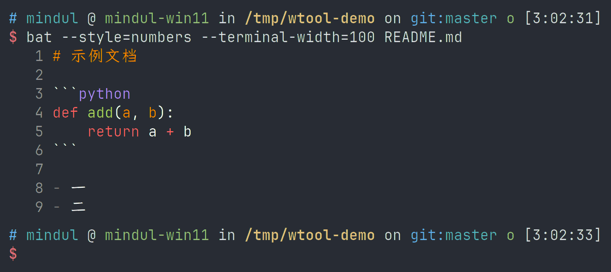

### eza

**功能**：`ls` 替代品：图标、Git 状态、树形。

```sh
eza -l                     # 长格式
eza -la --icons            # 带图标、含隐藏文件
eza -T -L 2                # 树形，最多两层
eza -l --sort=size -r      # 按大小反序
eza -l --git               # 带 git 状态
```

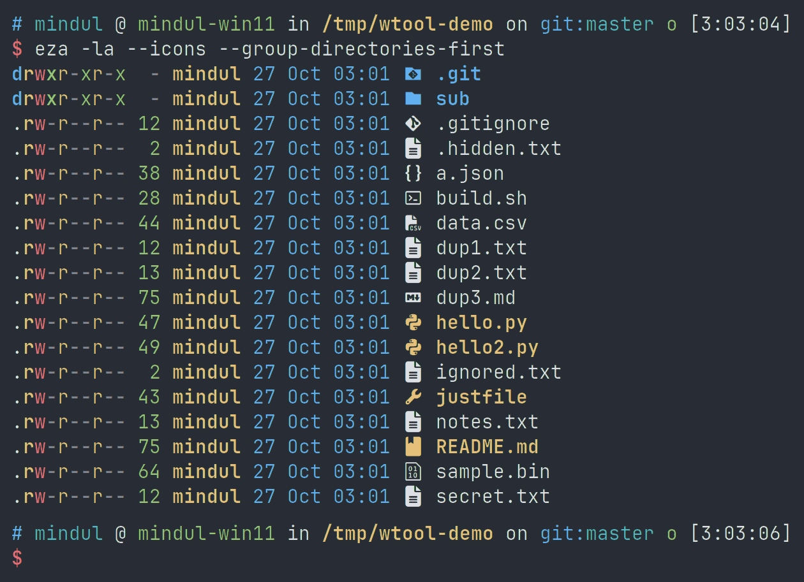

### delta

**功能**：给 `git diff` / `git show` 上色的分页器（并排、行号、语法高亮）。

```sh
git diff | delta           # 看当前改动
git show HEAD | delta      # 看某次提交
git log -p -1 | delta
```

**提示**：想让它默认生效，在 git 配置里把它设成 `core.pager`。

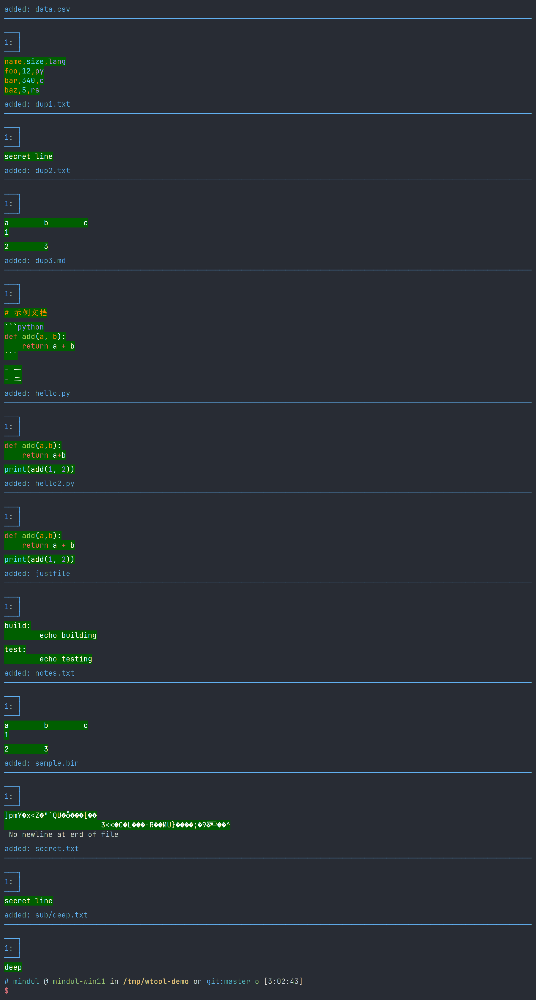

### dust

**功能**：磁盘占用树（比 `du` 直观）。

```sh
dust                       # 当前目录
dust -d 2                  # 只看两层
dust -n 10                 # 只列 10 行
dust -r                    # 反序（小的在前）
```

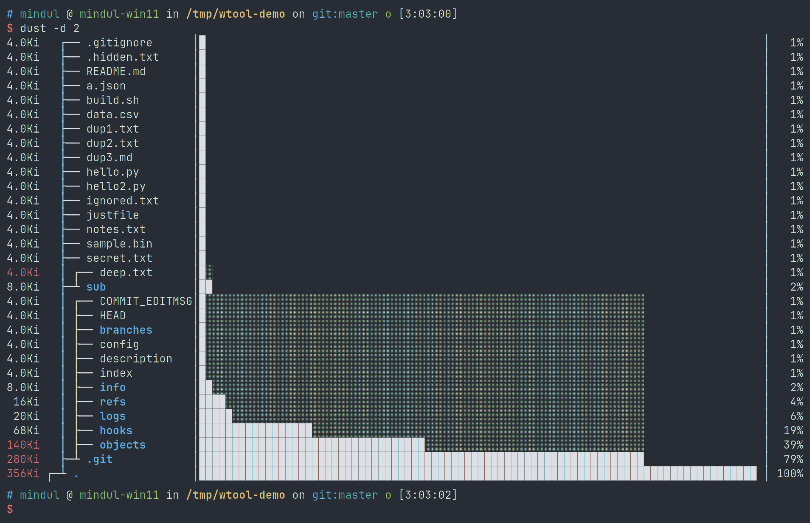

### duf

**功能**：磁盘使用概览（`df` 的可读版）。

```sh
duf                        # 所有挂载点
duf --only local           # 只看本地盘
duf --json                 # JSON 输出
```

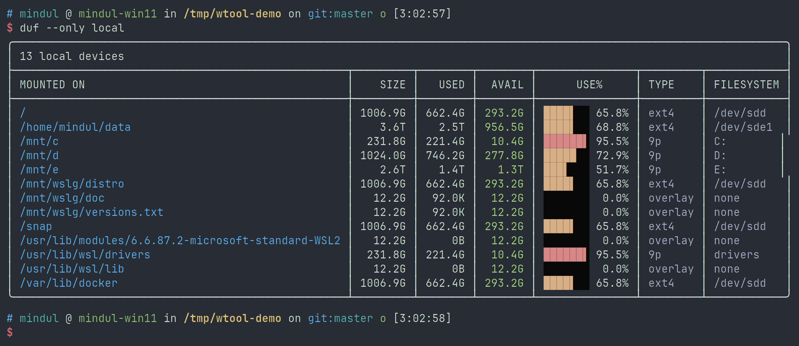

### procs

**功能**：`ps` 替代品，按列看进程（默认带 CPU/内存排序）。

```sh
procs                      # 全部进程
procs --sortd cpu          # 按 CPU 降序
procs bash                 # 只看名字含 bash 的
procs --tree               # 进程树
```

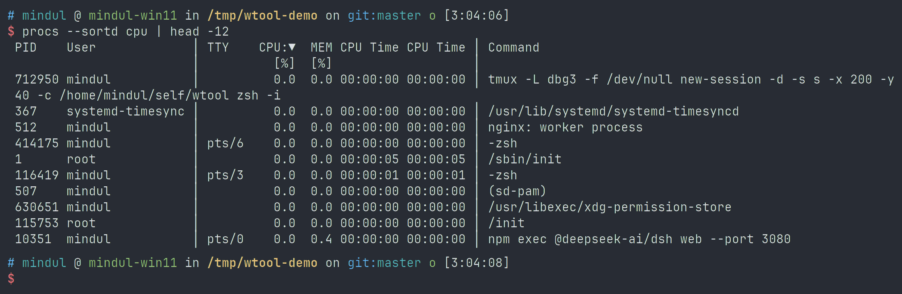

### btm

**功能**：终端系统监控（CPU / 内存 / 网络 / 磁盘的实时图）。TUI。

```sh
btm                        # 完整界面
btm -b                     # 精简界面（basic）
btm --battery              # 显示电池
```

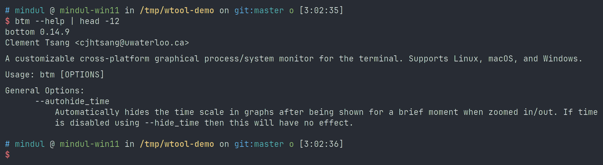

### jq

**功能**：JSON 处理（取字段、过滤、格式化）。

```sh
jq . a.json                # 格式化
jq -r '.tags[]' a.json     # 取数组元素，裸输出
jq -c . a.json             # 压成一行
jq 'keys' a.json           # 看有哪些键
```

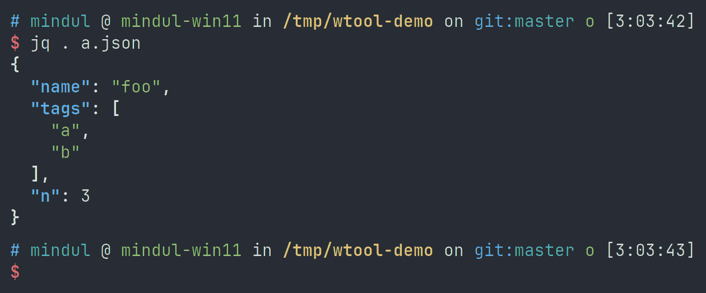

### gojq

**功能**：纯 Go 的 `jq`（同样的语法，单文件、好分发）。

```sh
gojq . a.json
gojq -c '.tags' a.json
gojq --yaml-input '.a' file.yaml
```

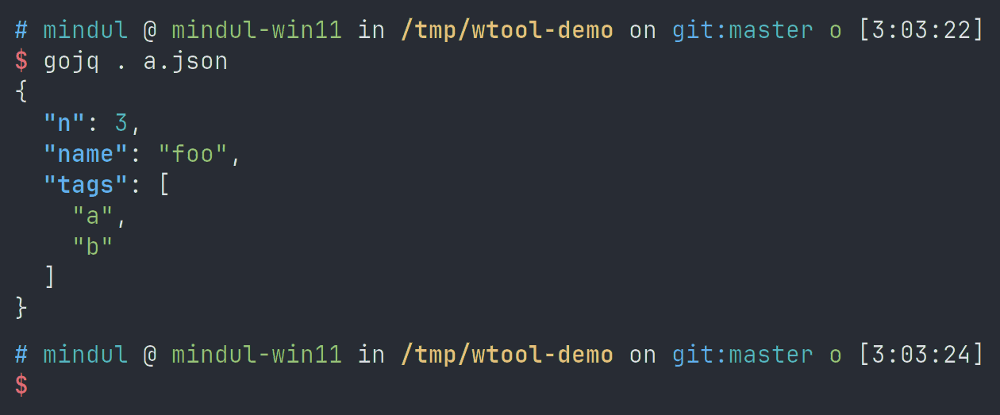

### yq

**功能**：YAML / JSON 查询与改写（`jq` 的 YAML 版）。

```sh
yq '.name' a.json          # 取字段
yq '.tags[]' a.json        # 取数组
yq -i '.n = 5' a.json      # 原地改（-i）
yq -o=json '.' file.yaml   # YAML → JSON
```

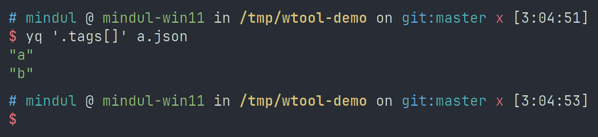

### sd

**功能**：查找替换（`sed` 的现代替代，默认正则）。

```sh
sd 'foo' 'bar' notes.txt          # 原地替换
sd -p 'py' 'python' data.csv      # 只预览（打印 diff，不写文件）
sd '(\w+)@' 'x@' file             # 正则分组
```

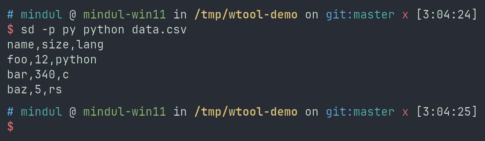

### hyperfine

**功能**：命令基准测试（多次跑、给统计和对比）。

```sh
hyperfine 'ls'                    # 单条
hyperfine -w 2 -m 5 'ls' 'eza'    # 预热 2 次、各跑 5 次，两条对比
hyperfine --export-json r.json 'ls'
```

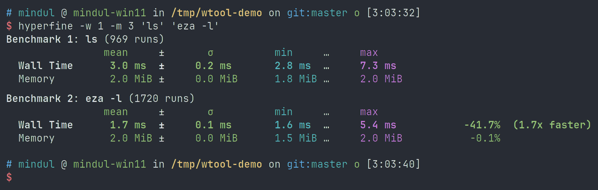

### just

**功能**：`justfile` 里的命令运行器（`make` 的现代替代）。

```sh
just --list                # 列出所有 recipe
just build                 # 跑某条
just build --release       # 参数原样传给 recipe
```

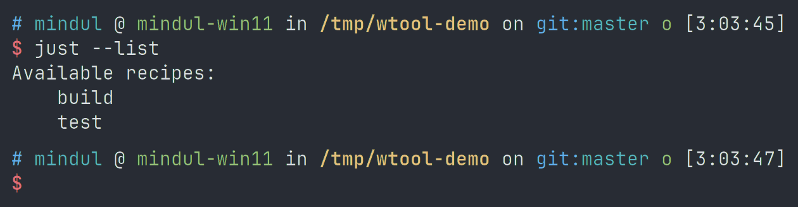

### scc

**功能**：代码行数统计（按语言、按文件）。

```sh
scc                        # 当前目录按语言汇总
scc --by-file              # 按文件
scc --format json          # JSON
```

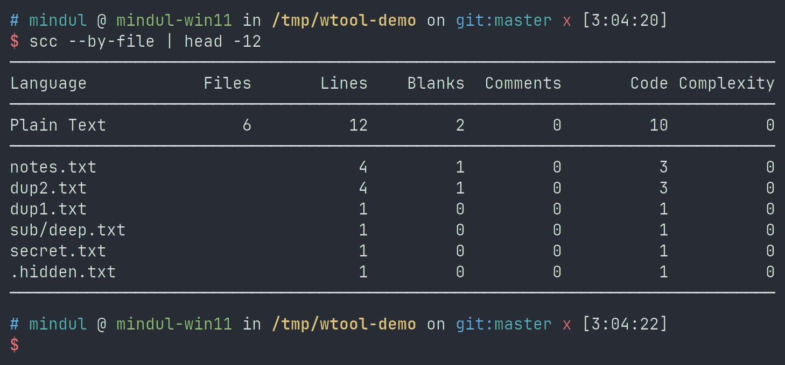

### difft

**功能**：语法感知的 diff（按语法树对齐，比行 diff 准）。命令名 `difft`，项目目录 `difftastic`。

```sh
difft a.py b.py            # 两个文件对比
difft --display inline a.py b.py
git diff | difft           # 当 git 的分页器用
```

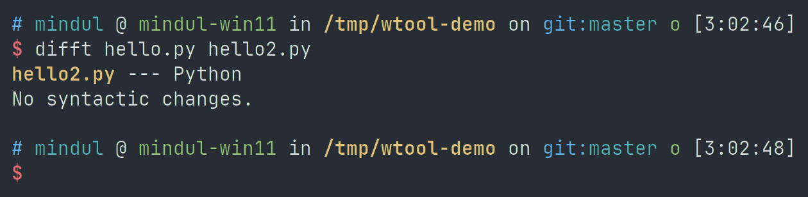

### fclones

**功能**：重复文件查找 / 去重 / 链接。

```sh
fclones group .            # 找出重复文件组
fclones group . --min-size 1K
fclones group . > dup.txt  # 存清单
fclones remove --dry-run dup.txt
```

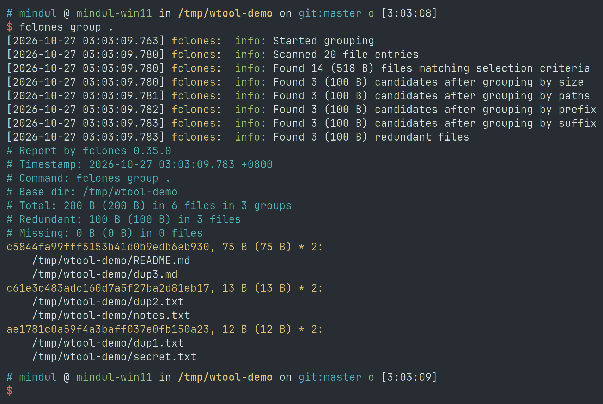

### shellcheck

**功能**：shell 脚本静态检查。

```sh
shellcheck build.sh        # 报问题
shellcheck -e SC2086 x.sh  # 忽略某类
shellcheck -f gcc x.sh     # gcc 风格输出（编辑器好接）
```

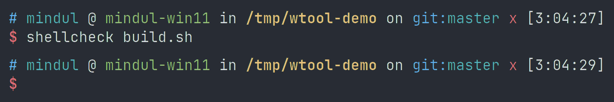

### shfmt

**功能**：shell 脚本格式化。

```sh
shfmt -d build.sh          # 只打印 diff
shfmt -w build.sh          # 原地写回
shfmt -l .                 # 列出需要格式化的文件
shfmt -i 2 -ci -w x.sh     # 缩进 2、case 也缩进
```

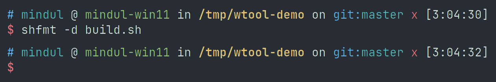

### age

**功能**：文件加密（现代、简单、可编程）。

```sh
age-keygen -o age-key.txt                          # 生成密钥
age -e -r <公钥> -o secret.txt.age secret.txt       # 加密给某个公钥
age -d -i age-key.txt secret.txt.age               # 解密
age -p file                                        # 用口令加密（交互）
```

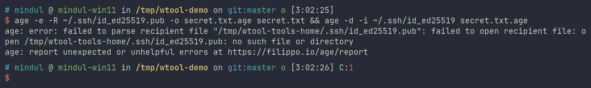

### b3sum

**功能**：BLAKE3 校验和。

```sh
b3sum secret.txt data.csv  # 算校验和
b3sum --check sums.txt     # 按清单校验
b3sum * > sums.txt         # 生清单
```

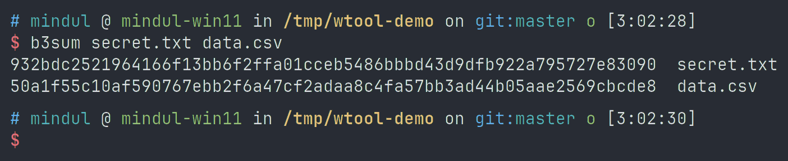

### glow

**功能**：在终端里渲染 Markdown。

```sh
glow README.md             # 渲染
glow -p README.md          # 分页器模式
glow -w 80 README.md       # 指定宽度
glow -l README.md          # 带行号
```

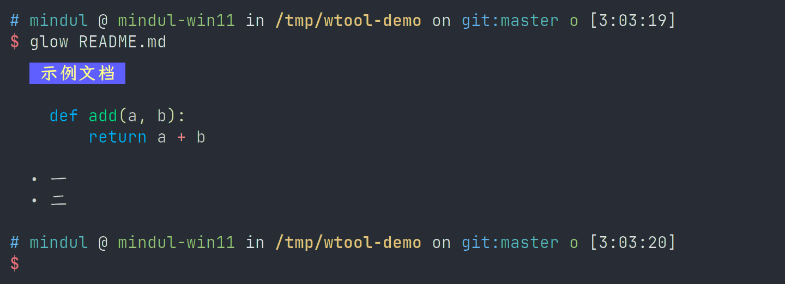

### xh

**功能**：HTTP 客户端（`httpie` 的 Rust 版）。

```sh
xh GET https://example.com             # GET
xh POST https://example.com name==foo  # 表单字段
xh -j PUT https://example.com/a.json < a.json   # JSON 体
xh --offline POST https://example.com  # 只打印将发出的请求，不联网
```

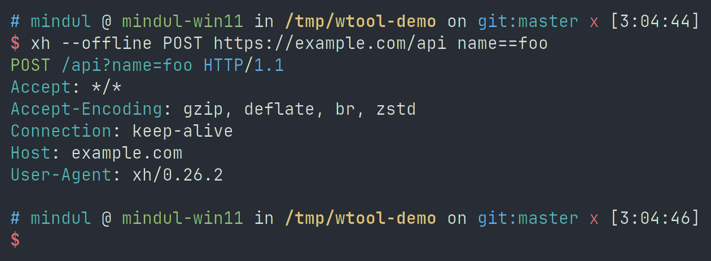

### gping

**功能**：带图的 ping（延迟曲线）。

```sh
gping 1.1.1.1              # 图形界面
gping -s 127.0.0.1         # 简易字符图（-s）
gping --watch-interval 2 host
```

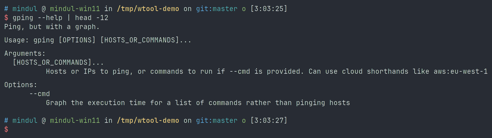

### trip

**功能**：网络诊断 / traceroute（TUI）。命令名 `trip`，项目目录 `trippy`。

```sh
sudo trip example.com      # 需要 raw socket（一般要 sudo）
sudo trip -m 5 example.com # 最多 5 跳
```

**提示**：它是全屏 TUI，本页只截它的帮助。

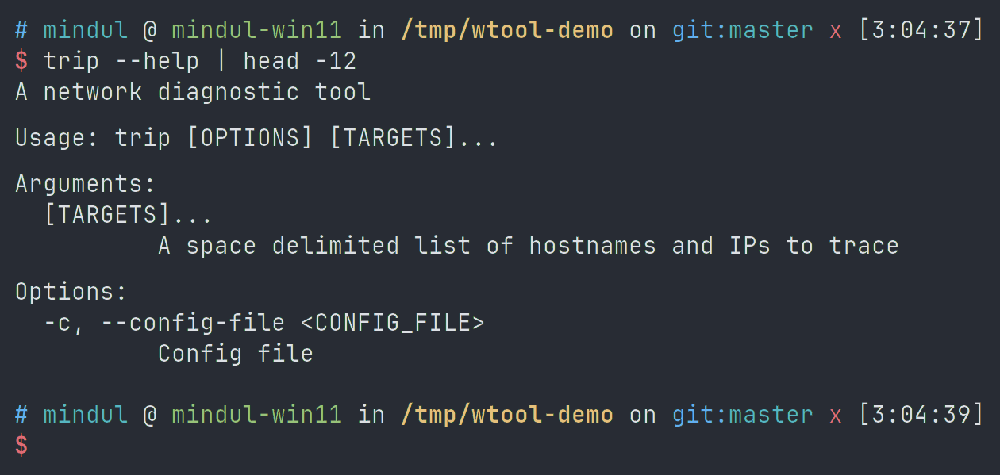

### yazi

**功能**：终端文件管理器（TUI，预览、批量）。

```sh
yazi                       # 当前目录
yazi /tmp/wtool-demo-files # 指定目录
```

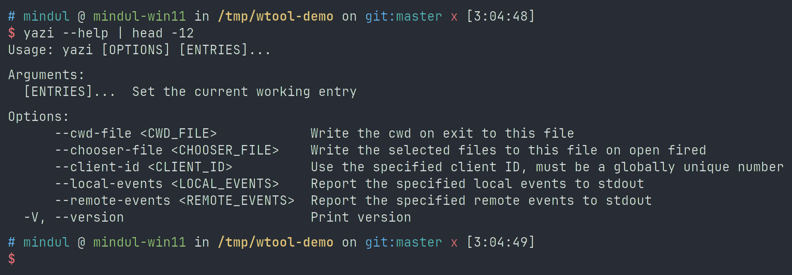

### zellij

**功能**：终端复用器（与 tmux 同类，布局用 KDL 描述）。

```sh
zellij list-sessions       # 有哪些会话
zellij                     # 起一个新会话
zellij attach <名字>        # 接回去
```

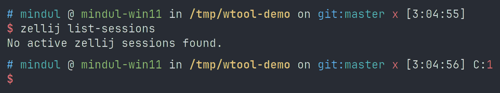

### lazygit

**功能**：Git 的终端界面（暂存、提交、分支、rebase 都在一屏）。

```sh
lazygit                    # 当前仓库
lazygit -p <仓库路径>       # 指定仓库
```

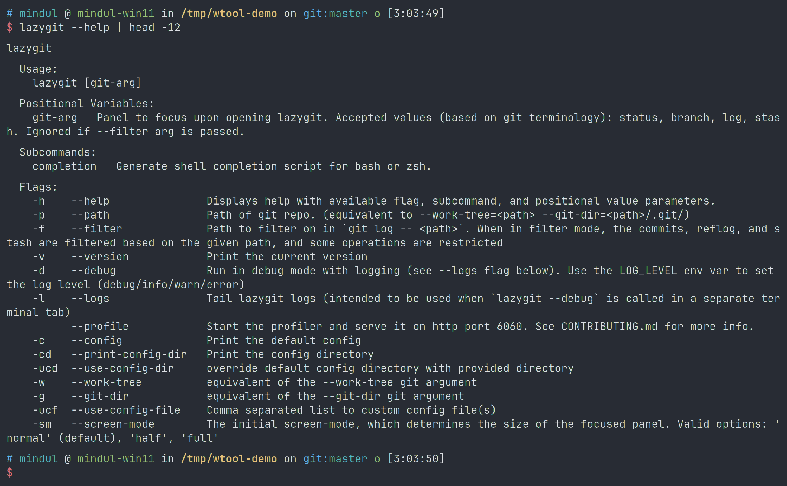

### dive

**功能**：看 docker 镜像的每一层，找出白占空间的文件。

```sh
dive nginx:latest                     # 分析镜像
dive --ci nginx:latest                # CI 里跑（非交互、按阈值报错）
dive build -t myimg .                 # 边构建边分析
```

**提示**：它需要 docker；本页只截帮助。

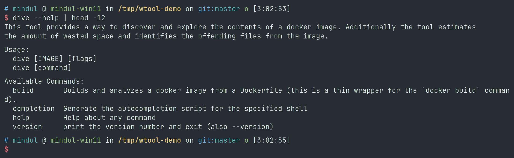

### fzf

**功能**：模糊查找（选择器；非交互时也能当过滤器用）。

```sh
ls | fzf                            # 交互式选
ls | fzf --filter=README            # 非交互过滤（直接给命中的行）
fzf --preview 'bat {}'              # 带预览
```

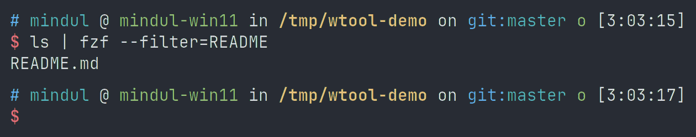

### zoxide

**功能**：智能 `cd`（按访问频率，`z` / `zi` 就是用它）。

```sh
zoxide query wtool         # 查最匹配的目录
zoxide query -l            # 列出库里的目录
zoxide add /tmp            # 手动加一条
```

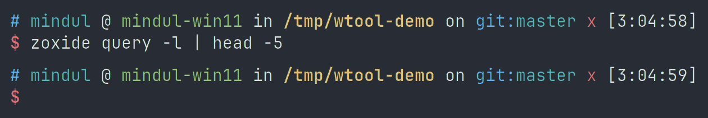

### direnv

**功能**：目录级环境变量（进目录自动加载 `.envrc`，出去自动卸）。

```sh
direnv allow               # 信任当前目录的 .envrc
direnv status              # 看当前状态和配置
direnv reload              # 重载
```

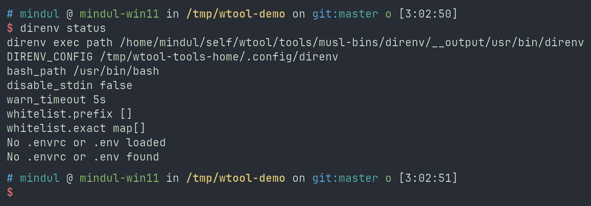

### starship

**功能**：通用提示符（跨 shell 的 PS1 生成器）。

```sh
starship prompt            # 打印当前提示符
starship init zsh          # 生成 zsh 初始化代码
starship config            # 打开配置
```

**提示**：装了 oh-my-zsh（`ys` 主题）时两者会抢提示符 —— 本项目让 `ys` 赢。

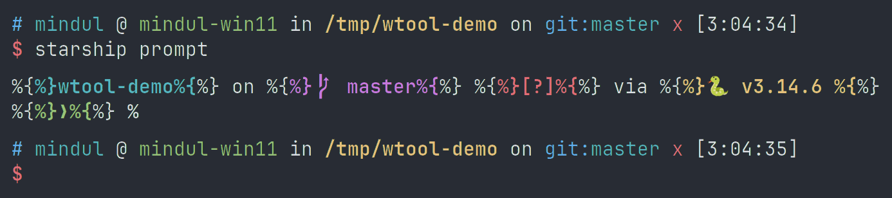

### navi

**功能**：命令速查（cheatsheet，`Ctrl-G` 就是打开它）。

```sh
navi                       # 交互式浏览
navi --print               # 选中后只打印命令，不执行
navi fn widget::last_command
```

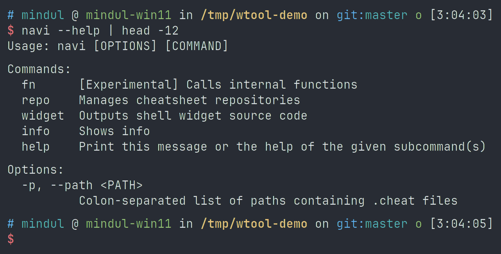

### rclone

**功能**：云存储同步（S3 / WebDAV / 各家网盘，一个命令）。

```sh
rclone listremotes         # 配了哪些远端
rclone lsd remote:         # 列目录
rclone sync src remote:dst # 单向同步
rclone copy file remote:dir
```

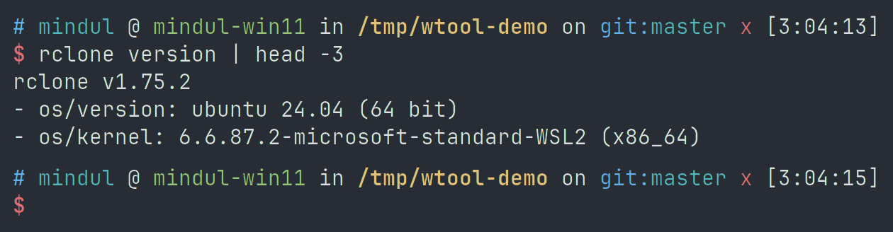

### mlr

**功能**：CSV / JSON / TSV 处理（`awk` 的表格式版）。命令名 `mlr`，项目目录 `miller`。

```sh
mlr --icsv --ojson cat data.csv        # CSV → JSON
mlr --csv cut -f name,size data.csv    # 选列
mlr --csv sort -f size data.csv        # 排序
mlr --csv stats1 -a mean -f size data.csv
```


### csvlens

**功能**：CSV 查看 / 过滤 / 排序（TUI）。

```sh
csvlens data.csv           # 打开
csvlens -t data.tsv        # tab 分隔
csvlens --filter foo data.csv
```


### watchexec

**功能**：文件一变就重跑命令。

```sh
watchexec -e py 'python3 hello.py'     # 改 .py 就重跑
watchexec -w src 'make'                # 只看 src/
watchexec -- ls                        # 每次都跑 ls
```


### lf

**功能**：终端文件管理器（vim 键位）。

```sh
lf                         # 当前目录
lf /tmp                    # 指定目录
```


### micro

**功能**：终端编辑器（键位接近常见编辑器，鼠标可用）。

```sh
micro notes.txt            # 打开/新建
micro -plugin list         # 插件
```


### hexyl

**功能**：十六进制查看（彩色、带偏移）。

```sh
hexyl sample.bin           # 全部
hexyl -n 32 sample.bin     # 只看前 32 字节
hexyl -s 16 sample.bin     # 从偏移 16 开始
```


### qsv

**功能**：CSV 处理（索引、切片、统计、SQL 查询）。

```sh
qsv stats data.csv         # 每列统计
qsv headers data.csv       # 表头
qsv select name,size data.csv
qsv slice -l 2 data.csv    # 前两行
```


### rg

**功能**：递归搜索（`grep` 替代，默认尊重 `.gitignore`）。命令名 `rg`，项目目录 `ripgrep`。

```sh
rg add                     # 递归搜 add
rg -n 'def ' .             # 带行号
rg -t py add               # 只在 python 文件里搜
rg -l foo                  # 只列文件名
rg --json foo              # 结构化输出
```


### fdfind

**功能**：`find` 替代（按名字/类型找文件，默认忽略隐藏和 `.gitignore`）。命令名 `fdfind`，项目目录 `fd`。

```sh
fdfind -e rs               # 按扩展名
fdfind --type f foo        # 只找文件
fdfind -H '\.hidden'       # 连隐藏文件一起
fdfind -x wc -l {}         # 对每个结果执行命令
```


## 其它命令（`$WTOOL_HOME/usr/bin`）

### zsh

**功能**：wtool 装的 zsh。

```sh
zsh --version             # zsh 5.9.2
zsh                        # 其余参数原样传
```

| 名字 | 说明 |
|---|---|
| `zsh-5.9.2` | 带版本号的 zsh 二进制（`zsh` 是它的软链） |


### wpack

**功能**：Android 镜像解包 / 打包（`android_repack` 项目提供的命令）。

```sh
wpack list                        # 列项目和类型
wpack unpack <项目>/<类型> <镜像> <工作目录>
wpack repack <项目>/<类型> <工作目录> <输出镜像>
wpack doctor                      # 自检
```


## 常见问题

### `env -i` 下 zsh 动态模块加载不到

`env -i ZDOTDIR=~/.wtool zsh` 会缺 `PATH`，补上就行：

```sh
env -i ZDOTDIR=~/.wtool PATH=/usr/bin:/bin zsh
```
